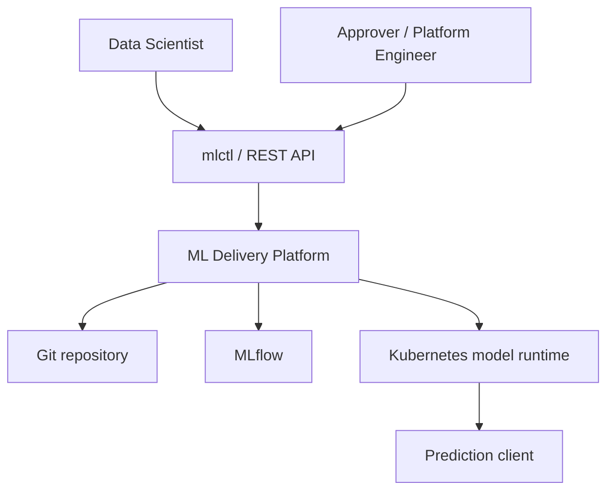
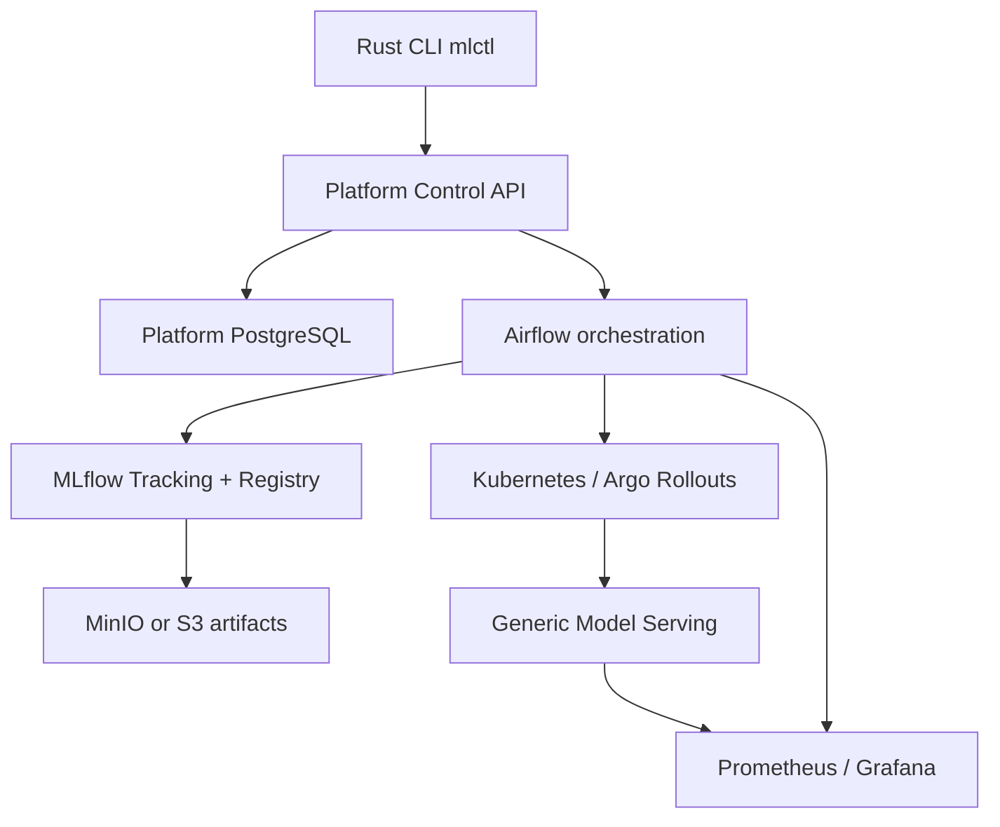
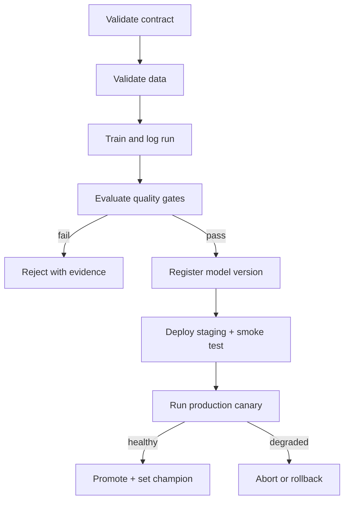
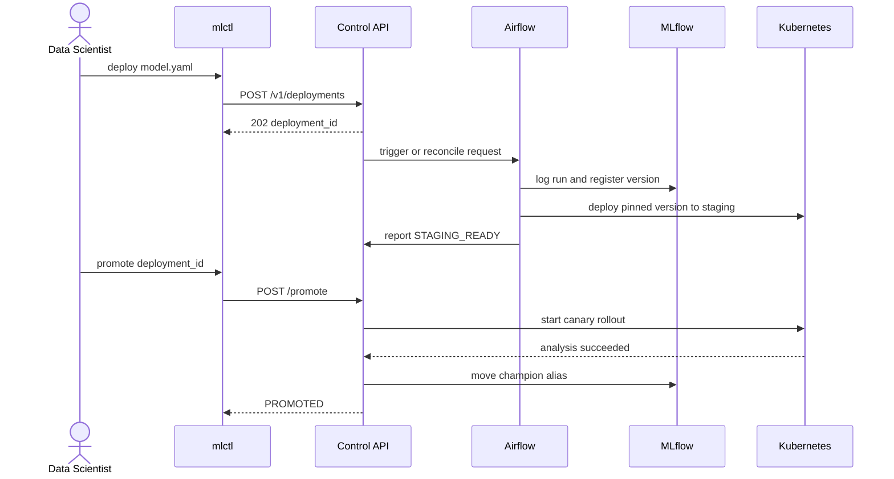
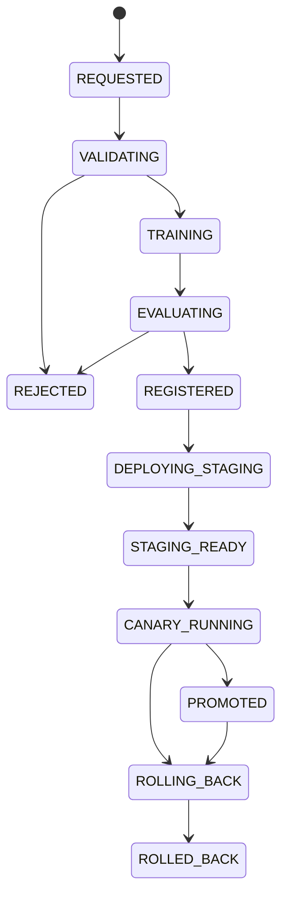
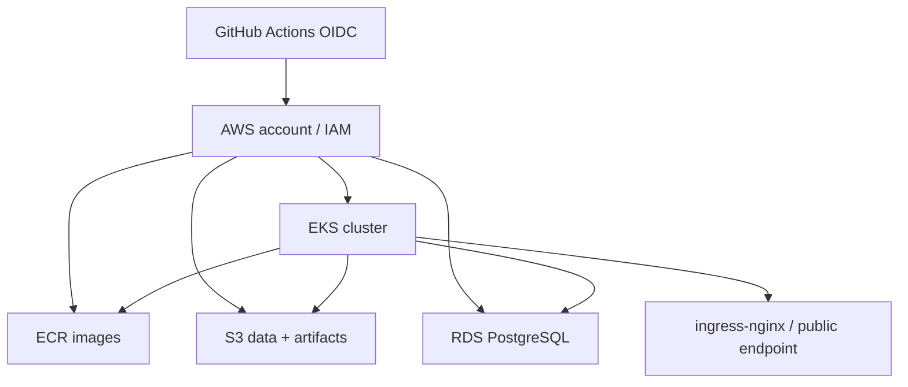

# ML Delivery Platform — Engineering Truth Paper

**Версія:** 1.0  
**Статус:** канонічна специфікація для першої повної реалізації  
**Дата:** 17 жовтня 2026  
**Орієнтовний горизонт реалізації:** 16 інтенсивних тижнів, 20–25 годин на тиждень  
**Основна хмара:** AWS  
**Основний локальний кластер:** kind  
**Мова документа:** українська; код, API, назви сутностей і публічна документація репозиторію — англійською

## Швидка навігація

| Частини | Зміст |
|---|---|
| 0–IV | правила документа, продукт, вимоги, архітектура, repository і model/data contracts |
| V–VIII | training SDK, MLflow, quality gates, serving, Control API, PostgreSQL та Airflow |
| IX–XVI | Docker, CI/CD, AWS, Terraform, Kubernetes, observability, Rust, security і versioning |
| XVII–XIX | testing, failure model, runbooks та engineering workflow |
| XX–XXI | детальний 16-тижневий implementation/learning plan і формат роботи з тьютором |
| XXII–XXV | acceptance, demo, portfolio, risks, open decisions і backlog |
| XXVI–XXIX | official references, glossary, перші 72 години й фінальна теза |

---

## 0. Як користуватися цим документом

Це не список технологій і не календар, який треба механічно виконувати. Це **truth paper** — узгоджена відповідь на запитання:

- що саме ми будуємо;
- для кого;
- яку проблему система вирішує;
- де проходять її межі;
- які компоненти існують і навіщо;
- які контракти між ними;
- що є джерелом істини для кожного виду стану;
- як система поводиться у штатних і аварійних сценаріях;
- що вважається завершеною реалізацією;
- у якій послідовності це доцільно будувати й вивчати.

На основі цього документа можна складати власний денний або тижневий план. Календар дозволено пересувати. Архітектурні контракти не слід непомітно змінювати під час реалізації.

### 0.1. Нормативні слова

- **MUST** — обов'язкова вимога першої повної версії.
- **SHOULD** — вимога, яку треба реалізувати, якщо вона не блокує завершення основного шляху.
- **MAY** — допустиме розширення після завершення основного шляху.
- **НЕ РОБИМО** — свідомо виключено з першої версії.

### 0.2. Як змінювати рішення

Якщо під час реалізації з'являється причина змінити зафіксоване рішення:

1. Не переписувати історію мовчки.
2. Створити короткий ADR у `docs/adr/NNNN-title.md`.
3. Описати контекст, варіанти, рішення, наслідки й спосіб міграції.
4. Оновити цей truth paper, якщо зміна впливає на зовнішній контракт або межі системи.

Формат ADR:

```markdown
# ADR-0001: Use PostgreSQL for control-plane state

Status: Accepted
Date: YYYY-MM-DD

## Context
## Considered options
## Decision
## Consequences
## Migration/rollback
```

### 0.3. Зафіксовані припущення

1. Проєкт робить одна людина, але код і документація мають виглядати так, ніби ними користуватиметься невелика команда.
2. Це portfolio-grade production-like система, а не реальний банк і не сертифікований продукт.
3. Основна мета — продемонструвати ML lifecycle, backend, infrastructure, delivery, observability і incident response як одну зв'язну систему.
4. Demo-модель проста навмисно. Інженерна складність — у її відтворюваній та безпечній доставці.
5. Локальне середовище має працювати без AWS. Хмарне середовище підіймається тимчасово для перевірки й демонстрації, після чого може бути повністю видалене.
6. Основна реалізація — Python. Rust використовується для окремого developer-facing CLI, а не для переписування ML-компонентів.

---

# Частина I. Сенс продукту

## 1. Одним реченням

**ML Delivery Platform — це внутрішня self-service платформа, яка бере versioned training code та декларативний `model.yaml`, а потім відтворювано проводить ML-модель через validation, training, experiment tracking, quality gates, registry, staging, canary, monitoring, promotion або rollback.**

## 2. Яку реальну проблему вона вирішує

Data Scientist може навчити модель у notebook, але між «у мене є `.pkl`» і «модель безпечно працює в production» лежать різні дисципліни:

- треба відтворити конкретні дані та код;
- перевірити схему даних і відсутність очевидних проблем;
- зберегти parameters, metrics, artifacts і lineage;
- порівняти candidate з поточним champion;
- перевірити, що artifact можна завантажити й викликати через стабільний API;
- зібрати immutable container image;
- підняти staging;
- виконати smoke та contract tests;
- дати candidate лише частину production-трафіку;
- спостерігати latency, errors і model-quality signals;
- автоматично або вручну зупинити невдалий rollout;
- знати, хто, коли, що й чому задеплоїв;
- швидко повернути попередню відому версію.

Без платформи кожна ML-команда створює цей шлях заново, часто вручну і по-різному. Платформа перетворює правильний шлях на стандартний reusable workflow.

## 3. Хто користувач

### 3.1. Основний користувач: Data Scientist / ML Engineer

Він або вона:

- пише training code;
- визначає feature schema, target, metric і thresholds;
- створює `model.yaml`;
- запускає validation/deployment через `mlctl` або API;
- дивиться experiment і quality-gate results;
- просить promotion після успішного staging/canary.

Користувач **не повинен** для кожної моделі писати власний Dockerfile, Airflow DAG, Helm chart, Prometheus instrumentation або rollback script.

### 3.2. Другий користувач: ML Platform Engineer

Він або вона:

- підтримує reusable templates;
- визначає platform policies;
- експлуатує control plane;
- аналізує failures;
- оновлює infrastructure;
- покращує onboarding і lead time.

### 3.3. Третій користувач: Approver / service owner

Він або вона:

- бачить evidence з quality gates і canary analysis;
- схвалює promotion або виконує rollback;
- читає audit trail та runbook.

У demo всі три ролі може виконувати одна людина, але їхні обов'язки мають бути розділені в API і документації.

## 4. Jobs to be done

Коли в мене є нова модель, я хочу:

1. Описати її стандартним контрактом.
2. Однією командою перевірити контракт локально.
3. Створити deployment request без ручного налаштування інфраструктури.
4. Отримати зрозумілу відповідь, чому модель пройшла або не пройшла gate.
5. Побачити точний зв'язок між Git commit, dataset snapshot, MLflow run, model version, image digest і deployment.
6. Безпечно перевести перевірену версію у production.
7. У разі деградації повернути попередню версію за хвилини, а не відновлювати контекст вручну.

## 5. Що є продуктом, а що лише demo workload

**Продукт:** reusable delivery platform, її контракти, control plane, pipelines, deployment templates, observability і CLI.

**Demo workload:** модель прогнозу дефолту за кредитною карткою на UCI Default of Credit Card Clients.

Це критичне розділення. Якщо код платформи називає колонки `LIMIT_BAL`, `AGE` або `PAY_0`, межу порушено. Такі знання мають жити тільки в `examples/credit_default/`.

## 6. Цілі першої повної версії

### 6.1. Product goals

- **G-01.** Нову сумісну модель можна підключити через training adapter і `model.yaml`, не змінюючи core platform code.
- **G-02.** Кожний deployment має наскрізний lineage.
- **G-03.** Невдала модель не доходить до production без явного обходу policy, а такого обходу в MVP немає.
- **G-04.** Повторення того самого запиту не створює дубльований deployment.
- **G-05.** Production rollout має canary та перевірений rollback.
- **G-06.** Локальний golden path відтворюється іншою людиною за README.
- **G-07.** Хмарна інфраструктура створюється й видаляється через Terraform.
- **G-08.** Ключові рішення, failures і manual actions залишають append-only audit trail.

### 6.2. Навчальні цілі

Після завершення проєкту автор повинен уміти не просто назвати, а пояснити й показати:

- lifecycle HTTP request у FastAPI;
- validation Pydantic-моделей і помилки API;
- PostgreSQL constraints, indexes, transaction boundaries та locks;
- SQLAlchemy Session lifecycle і Alembic migrations;
- Docker image layers, networks, volumes, healthchecks і Compose dependencies;
- різницю між MLflow backend store та artifact store;
- ідемпотентність і retries в orchestration;
- Kubernetes Deployment/Service/Ingress/probes/resources;
- Helm templating і environment-specific values;
- immutable images, CI gates і cloud identity через OIDC;
- Prometheus metric types, labels і histogram quantiles;
- різницю між service monitoring, data drift і delayed model performance;
- Rust ownership/error handling на реальному CLI;
- incident response і доказовий rollback.

## 7. Нецілі першої версії

Перша версія **не є**:

- зовнішнім multi-tenant SaaS;
- повною заміною SageMaker, Databricks, Kubeflow або Argo CD;
- notebook platform;
- feature store;
- realtime streaming platform;
- системою online learning;
- GPU scheduler;
- складним web dashboard;
- generalized AutoML;
- системою для недовіреного довільного коду;
- справжнім кредитним скорингом для прийняття рішень про людей.

### 7.1. Технології, які свідомо не додаються

- Kafka — немає streaming use case.
- Kubeflow — надто великий control plane для масштабу проєкту.
- Service mesh — mTLS і mesh traffic policy не є головною навчальною ціллю.
- DVC — dataset snapshots достатньо версіонувати manifest + checksum + S3 URI.
- Redis/Celery — Airflow LocalExecutor достатній для demo workload.
- React dashboard — CLI, MLflow UI, Grafana й OpenAPI вже покривають user journey.
- Власний model registry — цю відповідальність виконує MLflow.

## 8. Критерії успіху проєкту

Проєкт вважається реалізованим, якщо можна наживо показати всі сценарії:

1. **Happy path:** candidate проходить validation і gates, реєструється, доходить до staging, проходить smoke test, отримує canary-трафік і стає champion.
2. **Quality rejection:** навмисно гірша модель отримує `REJECTED`; причина доступна в API, MLflow та audit events; deployment не створюється.
3. **Duplicate request:** два однакові `deploy` із тим самим idempotency key повертають один deployment ID.
4. **Restart recovery:** Control API падає після commit, але до trigger Airflow; reconciler знаходить `REQUESTED` запис і запускає workflow рівно один раз логічно.
5. **Serving failure:** artifact несумісний або модель не завантажується; readiness залишається false, production traffic не надходить.
6. **Canary incident:** candidate навмисно має високу latency або error rate; rollout автоматично abort-иться або оператор виконує rollback.
7. **Second model:** інша невелика classification model проходить той самий pipeline без змін у core packages.
8. **Fresh-machine onboarding:** інша людина за документацією підіймає core local stack, застосовує migrations і робить prediction.
9. **Cloud recreation:** `terraform apply` + Helm створюють середовище, а `terraform destroy` видаляє його без ручного пошуку ресурсів.
10. **Interview narrative:** автор за 10–15 хвилин пояснює trade-offs, sources of truth, один incident і одну відхилену альтернативу.

## 9. Початкові SLO та engineering targets

Це demo targets, а не універсальні production promises. Вони мають бути configurable і підтверджені вимірюваннями.

| Показник | Початкова ціль | Де вимірюється |
|---|---:|---|
| Online inference availability | 99.5% під час контрольованого demo-вікна | Prometheus recording rule |
| HTTP 5xx rate | < 1% за 5 хвилин | Prometheus |
| `/predict` p95 latency | < 200 ms для одного record у demo environment | Prometheus histogram |
| `/predict` p99 latency | < 400 ms | Prometheus histogram |
| Deployment lead time | < 20 хв від request до `STAGING_READY` для demo model | audit events |
| Rollback time | < 2 хв від action до stable traffic | audit events + Argo Rollouts |
| Local onboarding | < 30 хв на машині з Docker | scripted observation |
| Second-model onboarding | < 2 години без core changes | Git diff + observation |
| API idempotency | 100% для однакового key + payload | integration test |
| Audit coverage | 100% state transitions мають event | DB invariant test |

---

# Частина II. Функціональні й нефункціональні вимоги

## 10. Функціональні вимоги

### 10.1. Model contract і validation

- **FR-001 MUST:** платформа приймає versioned `model.yaml`.
- **FR-002 MUST:** contract має JSON Schema і Pydantic representation.
- **FR-003 MUST:** невідома major version contract відхиляється.
- **FR-004 MUST:** CLI може виконати локальну structural validation без мережі.
- **FR-005 MUST:** server повторно валідує contract; довіряти лише CLI не можна.
- **FR-006 MUST:** validation errors містять field path, error code і human-readable message.

### 10.2. Training і experiment tracking

- **FR-010 MUST:** training run отримує immutable dataset snapshot URI/checksum і Git SHA.
- **FR-011 MUST:** preprocessing та model входять в один serializable inference pipeline.
- **FR-012 MUST:** MLflow зберігає parameters, metrics, artifacts, tags, signature та input example.
- **FR-013 MUST:** кожен run має correlation з `deployment_id`.
- **FR-014 MUST:** повторний task execution не створює логічно іншу модель без явної причини.

### 10.3. Quality gates

- **FR-020 MUST:** data schema gate виконується до training.
- **FR-021 MUST:** model metric gate порівнює candidate з абсолютним threshold.
- **FR-022 MUST:** якщо champion існує, candidate порівнюється з ним на тому самому immutable test snapshot.
- **FR-023 MUST:** contract compatibility, artifact load, prediction sanity, latency та artifact size входять у gate.
- **FR-024 MUST:** результат кожної перевірки має `passed`, observed value, threshold і reason.
- **FR-025 MUST:** failure будь-якого mandatory gate переводить request у `REJECTED`, а не в `FAILED`.

`REJECTED` означає коректну роботу платформи: candidate не відповідає policy. `FAILED` означає технічну несправність платформи або workflow.

### 10.4. Registry і serving

- **FR-030 MUST:** прийнятний artifact реєструється як конкретна MLflow model version.
- **FR-031 MUST:** deployment завжди pin-иться до integer model version та artifact digest, а не тільки до mutable alias.
- **FR-032 MUST:** `champion` alias змінюється лише після успішного production promotion.
- **FR-033 MUST:** generic serving image завантажує model artifact за URI/config на startup.
- **FR-034 MUST:** serving API має `/predict`, `/health`, `/ready`, `/model-info`, `/metrics`.
- **FR-035 MUST:** readiness стає true лише після успішного load і warm-up prediction.
- **FR-036 MUST:** request/response відповідають contract schema.

### 10.5. Control plane

- **FR-040 MUST:** API створює deployment request, повертає status і events.
- **FR-041 MUST:** API підтримує explicit promote і rollback actions.
- **FR-042 MUST:** create/promotion/rollback mutations ідемпотентні.
- **FR-043 MUST:** кожна зміна status і відповідний event записуються в одній DB transaction.
- **FR-044 MUST:** events append-only на рівні application permissions.
- **FR-045 MUST:** API не виконує training у request process.

### 10.6. Orchestration

- **FR-050 MUST:** Airflow керує довгим train-and-stage workflow.
- **FR-051 MUST:** task retries не дублюють зовнішні side effects.
- **FR-052 MUST:** великі artifacts не передаються через XCom; передаються тільки IDs, URIs та small metadata.
- **FR-053 MUST:** reconciler повторно запускає stuck `REQUESTED` jobs.
- **FR-054 MUST:** monitoring job запускається окремо від training pipeline.

### 10.7. Deployment і rollback

- **FR-060 MUST:** staging deployment передує production.
- **FR-061 MUST:** smoke tests перевіряють health, readiness, schema, known fixture і model metadata.
- **FR-062 MUST:** production використовує weighted canary.
- **FR-063 MUST:** canary analysis читає service metrics із Prometheus.
- **FR-064 MUST:** невдалий analysis abort-ить rollout і залишає попередній stable ReplicaSet.
- **FR-065 MUST:** manual rollback доступний з CLI/API та фіксується в audit log.

### 10.8. Observability

- **FR-070 MUST:** усі сервіси пишуть structured JSON logs.
- **FR-071 MUST:** request має correlation/request ID.
- **FR-072 MUST:** online service експортує traffic, errors і latency metrics.
- **FR-073 MUST:** platform експортує workflow/state-transition metrics.
- **FR-074 MUST:** окремий job рахує data/prediction drift.
- **FR-075 MUST:** performance після надходження labels вимірюється окремо від drift.

### 10.9. Developer experience

- **FR-080 MUST:** локальний core stack запускається documented command.
- **FR-081 MUST:** repository містить example contract, example requests і fixtures.
- **FR-082 MUST:** Rust CLI має `validate`, `deploy`, `status`, `events`, `promote`, `rollback`.
- **FR-083 SHOULD:** `status --watch` періодично оновлює стан до terminal state.
- **FR-084 SHOULD:** CLI генерує shell completions.

## 11. Нефункціональні вимоги

- **NFR-001 Reproducibility:** model lineage дозволяє визначити code SHA, dataset digest, dependency lock, parameters і MLflow run.
- **NFR-002 Reliability:** duplicate requests і task retries не мають створювати неконтрольовані дублікати.
- **NFR-003 Recoverability:** після process restart система відновлює роботу зі збереженого durable state.
- **NFR-004 Auditability:** manual і automatic transitions мають actor, timestamp, reason та correlation.
- **NFR-005 Security:** secrets не потрапляють у Git, image, logs, events або API responses.
- **NFR-006 Portability:** model-serving image та CLI не залежать від локального absolute path.
- **NFR-007 Testability:** бізнес-логіка відділена від framework/I/O, щоб quality gate та state machine тестувалися без повного stack.
- **NFR-008 Operability:** кожен alert має dashboard link і runbook action.
- **NFR-009 Cost awareness:** AWS resources tagged; є budget alert і documented teardown.
- **NFR-010 Explainability:** кожне автоматичне рішення повертає evidence, а не тільки boolean.
- **NFR-011 Accessibility:** README дозволяє почати без прихованих знань автора.
- **NFR-012 Maintainability:** одна відповідальність має одного source of truth.

---

# Частина III. Архітектура

## 12. Архітектурні принципи

1. **Contract first.** Спочатку визначається формат входу/виходу, потім реалізація.
2. **Control plane не виконує важку роботу.** Він приймає intent, зберігає durable state і координує.
3. **Data plane pin-иться до immutable версій.** Mutable aliases — зручність для людей, не deployment identity.
4. **Один тип даних — один source of truth.** Не дублювати MLflow metadata в platform DB.
5. **At-least-once delivery + idempotent consumers.** Ідеальна exactly-once магія не припускається.
6. **Fail closed.** Якщо gate, readiness або analysis не може довести безпечність, promotion не відбувається.
7. **Local first, cloud equivalent.** Спочатку семантика перевіряється локально; потім міняються adapters інфраструктури.
8. **Artifacts поза реляційною БД.** Великі файли живуть в object storage.
9. **Observability — частина контракту.** Метрики й logs додаються разом із feature.
10. **Простота перед масштабом.** Система для двох моделей не потребує архітектури для тисячі команд.

## 13. System context



Платформа не редагує training code користувача і не приймає бізнес-рішення. Вона стандартизує шлях від versioned source до керованого runtime.

## 14. Container-level архітектура



Діаграма показує логічні контейнери, а не обов'язково окрему VM для кожного.

## 15. Control plane і data plane

### 15.1. Control plane

Control plane відповідає на запитання: **що користувач хоче задеплоїти, який зараз стан операції, чи дозволена наступна дія і який audit trail?**

Компоненти:

- `mlctl`;
- Platform Control API;
- platform PostgreSQL;
- Airflow workflows;
- deployment/reconciliation logic;
- Terraform/Helm/GitHub Actions як механізми зміни середовища.

### 15.2. Data plane

Data plane відповідає на запитання: **як конкретна immutable model version обслуговує prediction traffic?**

Компоненти:

- stable і canary model-serving pods;
- Kubernetes Services/Ingress;
- model artifact, завантажений з MLflow/S3;
- prediction logs;
- serving metrics.

### 15.3. Чому поділ важливий

Якщо Airflow або Control API тимчасово недоступний, уже запущена production-модель має продовжувати відповідати. Якщо model pod має incident, control plane має залишитися доступним для rollback. Це різні failure domains.

## 16. Джерела істини

| Вид інформації | Source of truth | Що там не зберігаємо |
|---|---|---|
| Source code, `model.yaml`, schemas, IaC | Git commit | model binaries, secrets |
| Raw/processed dataset snapshots | MinIO/S3 URI + checksum manifest | великі blobs у Git |
| Experiment params/metrics/tags | MLflow backend PostgreSQL | deployment state |
| Model artifacts/signatures | MLflow artifact store в MinIO/S3 | копію artifact у platform DB |
| Registered model versions/aliases | MLflow Model Registry | Kubernetes rollout history |
| User deployment intent/status | Platform PostgreSQL | experiment metrics |
| Audit transitions/actions | `deployment_events` | mutable current-only log |
| Desired runtime release | Git/Helm values + deployment request | unversioned manual manifest |
| Actual workload state | Kubernetes API / Argo Rollouts | training lineage |
| Runtime metrics | Prometheus | raw request payloads |
| Dashboards | versioned Grafana provisioning files | secrets |
| Application logs | stdout collector / CloudWatch in AWS | plaintext sensitive features |
| Prediction records для monitoring | partitioned Parquet in object storage | висококардинальні Prometheus labels |
| Terraform state | protected remote state backend | application secrets у outputs |

## 17. Головні рішення та альтернативи

| Рішення | Обрано | Відхилена альтернатива | Причина |
|---|---|---|---|
| Cloud | AWS | одночасно AWS + Azure | один глибокий шлях сильніший за два поверхневі |
| Orchestrator | Airflow | Kubeflow Pipelines | достатній для batch workflow й менший learning surface |
| Registry | MLflow | власні registry tables | lifecycle вже реалізований MLflow |
| API database | PostgreSQL | SQLite | constraints, concurrency, locks, production-like migrations |
| ORM | SQLAlchemy 2.0 sync Session | AsyncSession одразу | low-throughput control API не виправдовує додаткову складність; sync route працює в thread pool |
| Data validation | Pandera | Great Expectations | компактний Python-first contract для одного tabular workload |
| Serving artifact | MLflow pyfunc зі sklearn Pipeline | bare pickle + handwritten preprocessing | зменшує train/serve skew, має signature |
| Local object store | MinIO | local bind mount | ближча S3 semantics |
| Local K8s | kind | minikube | легкий repeatable cluster у Docker і CI-friendly |
| Deployment packaging | Helm | копії YAML | reusable chart + environment values |
| Progressive delivery | Argo Rollouts + ingress-nginx | ручне масштабування Deployments | явні canary steps, analysis і abort/rollback |
| CLI | Rust | ще один Python CLI | окремий обґрунтований systems-language компонент |
| Web UI | не будуємо | React dashboard | MLflow UI, Grafana, Swagger і CLI покривають demo |

## 18. End-to-end lifecycle



### 18.1. Happy-path sequence



У реальному коді Airflow і rollout controller можуть повідомляти status через service layer або callback endpoint. Важлива семантика: durable state записується, transition перевіряється, event створюється атомарно.

## 19. Lineage chain

Для кожного успішного production release має будуватися ланцюг:

```text
deployment_id
  -> git_sha
  -> model.yaml digest
  -> dataset_snapshot_uri + dataset_sha256
  -> mlflow_run_id
  -> registered_model_name + model_version
  -> model_artifact_uri + artifact_digest
  -> serving_image_digest
  -> helm_release_revision / rollout_revision
  -> production timestamp + actor
```

Якщо хоча б одна ланка невідома, release не має повної reproducibility story.

---

# Частина IV. Репозиторій і контракти

## 20. Канонічна структура monorepo

```text
ml-delivery-platform/
├── README.md
├── CONTRIBUTING.md
├── LICENSE
├── Makefile
├── pyproject.toml
├── uv.lock
├── .env.example
├── .pre-commit-config.yaml
├── compose.yaml
├── packages/
│   ├── platform_contracts/
│   │   ├── src/platform_contracts/
│   │   │   ├── model_spec.py
│   │   │   ├── deployment.py
│   │   │   ├── errors.py
│   │   │   └── state_machine.py
│   │   └── tests/
│   ├── training_sdk/
│   │   ├── src/training_sdk/
│   │   └── tests/
│   └── quality_gates/
│       ├── src/quality_gates/
│       └── tests/
├── services/
│   ├── control_api/
│   │   ├── src/control_api/
│   │   │   ├── api/
│   │   │   ├── application/
│   │   │   ├── domain/
│   │   │   ├── infrastructure/
│   │   │   └── main.py
│   │   ├── migrations/
│   │   ├── Dockerfile
│   │   └── tests/
│   └── model_server/
│       ├── src/model_server/
│       ├── Dockerfile
│       └── tests/
├── orchestration/
│   ├── dags/
│   │   ├── train_and_stage.py
│   │   ├── deployment_action.py
│   │   └── monitor_models.py
│   ├── tasks/
│   └── tests/
├── cli/
│   └── mlctl/
│       ├── Cargo.toml
│       ├── src/
│       └── tests/
├── examples/
│   ├── credit_default/
│   │   ├── model.yaml
│   │   ├── train.py
│   │   ├── schema.py
│   │   ├── fixtures/
│   │   └── README.md
│   └── second_model/
├── schemas/
│   ├── model-spec-v1.schema.json
│   └── openapi.snapshot.json
├── infra/
│   ├── terraform/
│   │   ├── modules/
│   │   └── environments/dev/
│   ├── helm/model-service/
│   ├── helm/platform/
│   └── kind/
├── observability/
│   ├── prometheus/
│   ├── grafana/dashboards/
│   ├── alerts/
│   └── load/
├── scripts/
│   ├── bootstrap-local.sh
│   ├── create-dev-databases.sh
│   ├── seed-demo.sh
│   └── run-demo.sh
├── docs/
│   ├── architecture/
│   ├── adr/
│   ├── runbooks/
│   ├── postmortems/
│   ├── tutorials/
│   └── truth-paper.md
└── .github/
    └── workflows/
```

### 20.1. Правила залежностей

- `platform_contracts` не імпортує FastAPI, Airflow або SQLAlchemy.
- `quality_gates` працює з plain typed objects, а не з HTTP або DB sessions.
- `control_api.domain` не знає про FastAPI.
- `infrastructure` реалізує persistence і external clients.
- Airflow DAG-файли залишаються thin; бізнес-логіка імпортується з packages.
- Example model може залежати від `training_sdk`, але platform core не залежить від example.
- Rust CLI споживає JSON Schema/OpenAPI, а не імпортує Python code.

## 21. `model.yaml` — зовнішній контракт моделі

### 21.1. Повний приклад v1

```yaml
apiVersion: mlplatform.io/v1
kind: Model

metadata:
  name: credit-default
  owner: portfolio-user
  description: Educational probability-of-default classifier
  labels:
    domain: risk-demo
    team: personal-platform

source:
  trainingEntryPoint: examples.credit_default.train:train

data:
  datasetUri: s3://ml-platform-data/credit-default/snapshots/v1/data.parquet
  manifestUri: s3://ml-platform-data/credit-default/snapshots/v1/manifest.json
  targetColumn: default_payment_next_month
  split:
    strategy: stratified_random
    train: 0.70
    validation: 0.15
    test: 0.15
    randomSeed: 42
  schema:
    pythonRef: examples.credit_default.schema:CreditDefaultFrame

training:
  framework: sklearn
  algorithm: lightgbm_classifier
  parameters:
    n_estimators: 250
    learning_rate: 0.05
    max_depth: 5
    random_state: 42
  resources:
    cpu: "2"
    memory: 4Gi

evaluation:
  primaryMetric: roc_auc
  direction: maximize
  minimum: 0.70
  championTolerance: 0.005
  secondaryMetrics:
    - average_precision
    - brier_score
  gates:
    maxArtifactSizeMb: 100
    maxP95LatencyMs: 200
    requireFinitePredictions: true
    requireProbabilityRange: true

serving:
  mode: online
  requestSchemaRef: schemas/credit-default-request-v1.json
  responseSchemaRef: schemas/credit-default-response-v1.json
  maxBatchSize: 100
  timeoutMs: 1000
  replicas:
    min: 2
    max: 4
  resources:
    requests:
      cpu: 100m
      memory: 256Mi
    limits:
      cpu: 500m
      memory: 512Mi

deployment:
  strategy: canary
  canary:
    steps:
      - weight: 10
        pauseSeconds: 120
      - weight: 25
        pauseSeconds: 180
      - weight: 50
        manualApproval: true
      - weight: 100
  autoRollback:
    maxErrorRate: 0.01
    maxP95LatencyMs: 200

monitoring:
  enabled: true
  predictionLogSampleRate: 1.0
  drift:
    schedule: "0 3 * * *"
    alertThreshold: 0.20
  delayedLabels:
    enabled: true
    joinKey: record_id
```

### 21.2. Обов'язкові поля v1

| Поле | Сенс | Validation |
|---|---|---|
| `apiVersion` | major contract version | рівно `mlplatform.io/v1` |
| `kind` | resource type | рівно `Model` |
| `metadata.name` | stable model identity | DNS-like lowercase name, 3–63 chars |
| `metadata.owner` | accountable owner | non-empty |
| `source.trainingEntryPoint` | importable training callable | `module:function` |
| `data.datasetUri` | immutable snapshot location | scheme allowlist + non-empty version segment |
| `data.manifestUri` | checksum/metadata manifest | reachable during server validation |
| `data.targetColumn` | training target | must exist after data validation |
| `data.split` | reproducible split policy | sums to 1.0; seed required |
| `training.framework` | adapter selection | allowlist in v1 |
| `evaluation.primaryMetric` | comparison metric | supported metric registry |
| `evaluation.direction` | ordering | `maximize` or `minimize` |
| `evaluation.minimum` | absolute gate | finite number |
| `serving.requestSchemaRef` | public request contract | committed file, valid JSON Schema |
| `serving.responseSchemaRef` | public response contract | committed file, valid JSON Schema |
| `deployment.strategy` | rollout type | `canary` in v1 |

### 21.3. Validation layers

1. **YAML parse:** файл синтаксично коректний, duplicate keys заборонені.
2. **JSON Schema:** типи, required fields, enums, ranges, unknown fields.
3. **Pydantic semantic validation:** split sums, consistent metric direction, canary reaches 100%, resource syntax.
4. **Repository validation:** referenced files та import path існують на заданому Git SHA.
5. **Environment validation:** URI доступний, credentials мають мінімальні permissions.
6. **Runtime contract validation:** artifact signature узгоджується з serving schemas.

### 21.4. Версіонування contract

- Додавання optional field із backward-compatible default — minor evolution у межах `v1`.
- Зміна semantics, removal/rename required field або зміна default поведінки — `v2`.
- Server підтримує current major і, за можливості, попередній major протягом migration window.
- JSON Schema генерується з Python Pydantic model командою `make generate-schemas`.
- CI запускає generation і падає, якщо committed schema відрізняється.
- Rust CLI містить/завантажує саме versioned schema й окремо показує unsupported version.

### 21.5. Безпека contract

`model.yaml` не містить:

- plaintext passwords/tokens;
- довільних shell commands;
- необмежених image names із випадкових registries;
- Python pickle URI поза trusted artifact store;
- cloud access keys.

Посилання на secret задається логічним ім'ям, а resolve відбувається environment-specific механізмом.

## 22. Demo dataset і data lifecycle

### 22.1. Dataset

Основний приклад — UCI Default of Credit Card Clients:

- 30 000 observations;
- 23 input features;
- binary classification target;
- open dataset із CC BY 4.0;
- достатньо малий для локального training;
- достатньо реалістичний для schema validation, imbalance metrics і drift demo.

Це **освітній workload**. Модель не позиціонується як придатна для реальних кредитних рішень. Sensitive/demographic columns роблять ethics note обов'язковим.

### 22.2. Ingestion

Перший ingestion script:

1. Завантажує dataset з відомого source.
2. Зберігає raw файл незмінним.
3. Рахує SHA-256.
4. Нормалізує назви колонок один раз у documented transform.
5. Зберігає Parquet snapshot.
6. Створює `manifest.json`.
7. Завантажує raw, processed і manifest у versioned object-storage prefix.

Приклад manifest:

```json
{
  "dataset_name": "credit-default",
  "snapshot_version": "v1",
  "source_url": "https://archive.ics.uci.edu/dataset/350/default+of+credit+card+clients",
  "license": "CC BY 4.0",
  "created_at": "2026-10-20T18:00:00Z",
  "raw_sha256": "...",
  "processed_sha256": "...",
  "rows": 30000,
  "feature_count": 23,
  "target": "default_payment_next_month",
  "transform_version": "git:<sha>"
}
```

### 22.3. Data contract

Pandera schema MUST перевіряти:

- exact/allowed columns;
- types і coercion policy;
- target values `{0, 1}`;
- nullability;
- unique/non-null record ID;
- logical ranges, наприклад positive age й non-negative credit limit;
- allowed categories там, де dataset documentation їх визначає;
- dataset-level row-count lower bound;
- duplicate rate;
- target prevalence range як warning або gate.

Не слід бездумно «виправляти» невідомі category values. Validation report має показати failure cases і вимагати explicit cleaning policy.

### 22.4. Split policy

- Один deterministic stratified split за seed 42.
- Test set фіксується для candidate/champion comparison.
- Preprocessing fit-иться лише на training split.
- Validation використовується для tuning/selection.
- Test не використовується для tuning.
- Split assignment або stable record IDs зберігаються як artifact, щоб повторний run використовував ті самі records.

### 22.5. Data leakage checks

MUST:

- target не входить у features;
- `ID` не використовується як predictive feature;
- transformations fit only on train;
- candidate і champion оцінюються на одному snapshot/split;
- training timestamps або post-outcome features, якщо з'являться, явно блокуються.

### 22.6. Synthetic drift stream

Для демонстрації monitoring створюється replay job, який:

- читає test records;
- у normal режимі зберігає початковий distribution;
- у drift режимі змінює вибрані numerical/categorical distributions;
- викликає production endpoint;
- пише sanitized prediction records;
- через configurable delay додає labels для performance calculation.

Це дає контрольований repeatable incident замість очікування реальних користувачів.

---

# Частина V. Training, tracking і quality policy

## 23. Training SDK і adapter contract

### 23.1. Навіщо потрібен SDK

Airflow не повинен знати, як навчається конкретний LightGBM або Logistic Regression. Конкретна модель не повинна знати, як створюється MLflow run, як формується audit event або як Kubernetes робить rollout. Між ними потрібен малий стабільний interface.

### 23.2. Python contract

Концептуально training entry point реалізує:

```python
from training_sdk import TrainingContext, TrainingResult


def train(context: TrainingContext) -> TrainingResult: ...
```

`TrainingContext` містить:

- `deployment_id`;
- parsed immutable `ModelSpec`;
- `git_sha`;
- `dataset_uri` і verified checksum;
- local working directory;
- random seed;
- MLflow tracking URI та experiment name;
- environment name;
- structured logger.

`TrainingResult` містить:

- `mlflow_run_id`;
- primary і secondary metrics;
- artifact URI;
- artifact digest;
- input/output signature;
- dataset digest;
- train/validation/test counts;
- dependency lock digest;
- optional warnings.

SDK не повертає в пам'яті великий DataFrame або model object між Airflow tasks. Він повертає small metadata й URIs.

### 23.3. Внутрішня структура example training code

```text
load snapshot
  -> validate checksum
  -> validate Pandera schema
  -> apply persisted split assignment
  -> build sklearn preprocessing Pipeline
  -> fit candidate
  -> evaluate validation/test
  -> log params, metrics, plots and model
  -> return immutable TrainingResult
```

Використовувати `sklearn.pipeline.Pipeline` і `ColumnTransformer`, щоб imputing, scaling та encoding подорожували разом із model artifact. Інакше легко отримати train/serve skew.

### 23.4. Baseline і candidate

- **Baseline:** Logistic Regression із простим, прозорим preprocessing.
- **Candidate:** LightGBM classifier.
- Baseline потрібен не як слабка формальність, а як sanity check: складніша модель має показати вимірювану користь.
- Hyperparameter search першої версії обмежений кількома явно заданими runs. Не будуємо AutoML.

### 23.5. Reproducibility controls

Кожний run MUST логувати:

- exact Git SHA;
- dirty-worktree flag; production request із dirty worktree заборонений;
- `model.yaml` SHA-256;
- dataset manifest і SHA-256;
- train/validation/test assignment artifact;
- seed;
- parameters;
- Python version;
- lockfile digest;
- container image digest, якщо training у container;
- platform version.

Best-effort determinism не означає математично ідентичний результат на будь-якому CPU. README має чесно розділяти deterministic inputs і hardware/library nondeterminism.

### 23.6. Trusted-code boundary

Training entry point — trusted repository code, reviewed через pull request. Перша версія не приймає довільний uploaded Python від зовнішнього користувача. Інакше потрібні sandboxing, quotas, image policy та сильніша isolation модель, що не входить у scope.

## 24. MLflow Tracking і Model Registry

### 24.1. Ролі MLflow

MLflow виконує чотири функції:

1. Tracking runs, parameters, metrics і tags.
2. Зберігання run artifacts через object store.
3. Packaging/signature model artifact.
4. Registry з model versions та aliases.

MLflow **не** зберігає стан platform deployment request і не замінює audit log.

### 24.2. Storage topology

Локально:

- metadata backend: PostgreSQL logical database `mlflow`;
- artifacts: bucket `mlflow-artifacts` у MinIO;
- tracking server: окремий container;
- clients звертаються тільки до tracking server.

В AWS:

- metadata backend: окрема logical database/schema на RDS instance;
- artifacts: versioned S3 bucket/prefix;
- workload access: IAM role, не static access key у image.

### 24.3. Naming

Experiment:

```text
/<environment>/<model_name>
```

Наприклад: `/dev/credit-default`.

Registered model:

```text
<model_name>
```

Обов'язкові run tags:

```text
platform.deployment_id
platform.git_sha
platform.spec_sha256
platform.dataset_sha256
platform.environment
platform.pipeline_version
platform.run_kind=candidate|baseline|monitoring
```

### 24.4. Що логувати

**Parameters:** algorithm, hyperparameters, seed, feature list/version, split policy.  
**Metrics:** train/validation/test ROC AUC, average precision, Brier score, confusion-matrix values at documented threshold, training duration, artifact size, benchmark latency.  
**Artifacts:** model, input example, signature, evaluation JSON, confusion matrix, ROC/PR plots, feature importance where meaningful, dataset manifest, split assignment, dependency snapshot, model card.  
**Tags:** lineage і platform correlation.

### 24.5. Registry lifecycle

1. Training log-ить candidate як run artifact.
2. Quality gate перевіряє artifact і metrics.
3. Лише `PASS` artifact реєструється як нова integer model version.
4. Version отримує tags `deployment_id`, `git_sha`, `dataset_sha256`, `gate_result=passed`.
5. Optional alias `candidate` може вказувати на останню прийнятну version.
6. Staging і canary завжди використовують exact version.
7. Після успішного rollout alias `champion` переводиться на цю version.
8. Попередня champion version не видаляється і доступна для rollback.

### 24.6. Concurrency захист promotion

Deployment request запам'ятовує `expected_champion_version`, з якою candidate порівнювався. Перед promotion система повторно читає `champion`:

- якщо version не змінилася — promotion продовжується;
- якщо інший deployment уже змінив champion — action повертає conflict і вимагає re-evaluation або explicit нового request;
- alias не пересувається «останній запис переміг» без перевірки.

### 24.7. Model card artifact

Кожна registered version має Markdown/JSON model card:

- призначення й нецілі;
- dataset і license;
- features/target;
- metrics із confidence/context;
- known limitations;
- ethical note;
- training date/code/data lineage;
- serving schema;
- quality-gate results;
- owner і rollback target.

## 25. Quality Gate Engine

### 25.1. Принцип

Gate — pure policy evaluation над зібраними evidence. Він не повинен приховувати рішення у великому Airflow task.

Typed result:

```python
class CheckResult(BaseModel):
    name: str
    passed: bool
    observed: str | float | int | None
    operator: str
    threshold: str | float | int | None
    severity: Literal["mandatory", "warning"]
    reason: str


class GateReport(BaseModel):
    policy_version: str
    passed: bool
    checks: list[CheckResult]
    candidate_run_id: str
    champion_version: int | None
```

`GateReport.passed` дорівнює `all(check.passed for mandatory checks)`. Warning не блокує, але відображається.

### 25.2. Gate order

1. Spec validation.
2. Dataset manifest/checksum.
3. Data schema and quality.
4. Successful training.
5. Model artifact load.
6. Signature compatibility.
7. Prediction sanity.
8. Absolute metric threshold.
9. Candidate/champion comparison.
10. Latency benchmark.
11. Artifact size/resource policy.
12. Complete lineage.

Дешеві перевірки йдуть раніше за дорогі.

### 25.3. Початкова policy для credit-default

| Check | Початкова умова | Тип |
|---|---|---|
| Schema | усі mandatory Pandera checks pass | mandatory |
| Dataset checksum | збігається з manifest | mandatory |
| Finite prediction | 100% finite | mandatory |
| Probability bounds | усі значення в `[0, 1]` | mandatory |
| Primary metric | test ROC AUC ≥ 0.70 | mandatory |
| Champion non-inferiority | candidate ROC AUC ≥ champion ROC AUC − 0.005 | mandatory |
| Average precision | логувати й показувати | warning на старті |
| Brier score | логувати; lower is better | warning на старті |
| p95 latency | ≤ 200 ms у reference benchmark | mandatory |
| Artifact size | ≤ 100 MiB | mandatory |
| Input/output contract | fixture round trip passes | mandatory |
| Lineage | усі required IDs/digests наявні | mandatory |

Thresholds після першого baseline run мають бути зафіксовані ADR, а не підігнані під кожного candidate.

### 25.4. Fair comparison

Candidate і champion MUST:

- оцінюватися на одному test snapshot;
- отримувати однакові records в однаковому порядку;
- використовувати одну metric implementation;
- запускатися у тому самому benchmark container/resource limit;
- пройти warm-up до latency measurement;
- мати достатню кількість викликів, наприклад 500–1000, а не один випадковий request.

### 25.5. Gate outcomes

- `PASS`: реєструвати й рухатися до staging.
- `REJECT`: business/policy outcome; записати весь report; workflow завершується успішно з доменним status `REJECTED`.
- `ERROR`: evidence не вдалося отримати через технічну проблему; retry, а після вичерпання — `FAILED`.

### 25.6. Зберігання evidence

- повний `gate-report.json` — MLflow artifact;
- summary — `deployment_events.payload`;
- selected values — MLflow metrics/tags;
- binary artifact у platform DB не копіюється.

---

# Частина VI. Model Serving

## 26. Generic model server

### 26.1. Відповідальність

Model server:

- завантажує exact MLflow model version;
- валідує public request;
- викликає model predict/predict_proba;
- формує стабільну response schema;
- експортує health/readiness/metrics/model metadata;
- пише sanitized prediction events для monitoring.

Model server не навчає модель, не приймає рішення про promotion і не змінює registry alias.

### 26.2. Startup lifecycle

1. Process стартує з `ready=false`.
2. Читає settings із environment.
3. Перевіряє required variables.
4. Resolve-ить pinned model URI/version.
5. Завантажує artifact у read-only cache.
6. Перевіряє digest/signature.
7. Виконує warm-up prediction на committed fixture.
8. Записує `model_loaded_info=1` labels із low cardinality.
9. Встановлює `ready=true`.

Якщо крок 4–7 падає, liveness може залишатися healthy, але readiness MUST бути false. Це дозволяє бачити process і не надсилати йому traffic.

### 26.3. Endpoints

| Method/path | Призначення | Auth | Коди |
|---|---|---|---|
| `POST /v1/predict` | prediction для 1..N records | bearer/API token у cloud | 200, 400, 413, 422, 500, 503 |
| `GET /health` | process alive | none inside cluster | 200 |
| `GET /ready` | model loaded and usable | none inside cluster | 200 або 503 |
| `GET /model-info` | safe lineage metadata | token або internal | 200, 503 |
| `GET /metrics` | Prometheus exposition | cluster-only | 200 |

### 26.4. Prediction request

```json
{
  "request_id": "client-generated-optional-uuid",
  "instances": [
    {
      "limit_bal": 20000,
      "sex": 2,
      "education": 2,
      "marriage": 1,
      "age": 24
    }
  ]
}
```

У реальному schema будуть усі потрібні model features. `request_id` генерується server-side, якщо його немає. Batch size обмежений `model.yaml`; oversized request повертає 413.

Response:

```json
{
  "request_id": "baf4...",
  "model": {
    "name": "credit-default",
    "version": 7
  },
  "predictions": [
    {
      "label": 0,
      "probability": 0.1842
    }
  ]
}
```

### 26.5. Error envelope

Усі application errors використовують:

```json
{
  "error": {
    "code": "INVALID_INPUT",
    "message": "Request does not match model input schema",
    "details": [
      {"path": "instances.0.age", "reason": "must be greater than 0"}
    ],
    "request_id": "baf4..."
  }
}
```

Stack traces ніколи не повертаються клієнту.

### 26.6. Settings

Pydantic Settings читає:

```text
MODEL_NAME
MODEL_VERSION
MODEL_URI
MODEL_ARTIFACT_SHA256
MLFLOW_TRACKING_URI
PREDICTION_LOG_URI
PREDICTION_LOG_SAMPLE_RATE
MAX_BATCH_SIZE
REQUEST_TIMEOUT_MS
LOG_LEVEL
ENVIRONMENT
```

Config validation виконується на startup. Secret values виключаються з repr/logging.

### 26.7. Concurrency й blocking inference

Sklearn/LightGBM prediction є синхронним CPU-bound call. Перша версія використовує sync FastAPI route (`def`) і bounded worker threads/processes. Не слід оголошувати `async def`, а потім блокувати event loop CPU inference.

Load test визначає:

- worker count;
- maximum concurrency;
- timeout;
- batch-size effect;
- CPU/memory requests and limits.

### 26.8. Artifact safety

Pickle-based sklearn artifacts можуть виконати код при deserialization. Тому:

- server завантажує лише artifacts із trusted MLflow registry;
- exact digest перевіряється;
- registry write дозволений тільки trusted pipeline identity;
- model container працює non-root;
- artifact не приймається напряму з public request;
- dependency versions pin-яться.

---

# Частина VII. Platform Control API і PostgreSQL

## 27. Control API responsibility

Control API — thin durable coordinator. Він:

- приймає deployment intent;
- перевіряє auth, payload, idempotency і state transition;
- зберігає current state;
- додає immutable audit event;
- запускає або дозволяє асинхронну orchestration;
- повертає user-facing representation.

Він не виконує training, Terraform apply або довгий rollout у HTTP request.

## 28. Public API v1

### 28.1. Створити deployment

```http
POST /v1/deployments
Authorization: Bearer <token>
Idempotency-Key: <uuid-or-stable-key>
Content-Type: application/json
```

```json
{
  "model_name": "credit-default",
  "git_sha": "40-char-commit-sha",
  "spec_path": "examples/credit_default/model.yaml",
  "target_environment": "dev"
}
```

Перший успішний виклик: `202 Accepted`.  
Повтор із тим самим key і canonical payload: `200 OK` з тим самим deployment.  
Той самий key з іншим payload: `409 IDEMPOTENCY_KEY_REUSED`.

### 28.2. Прочитати deployment

```http
GET /v1/deployments/{deployment_id}
```

Response містить:

- identity/status;
- model/git/spec/environment;
- MLflow run/model version після появи;
- expected/current champion;
- image/artifact digest після появи;
- timestamps;
- rejection/failure summary;
- allowed next actions;
- links на events/MLflow/Grafana, якщо доступні.

### 28.3. Events

```http
GET /v1/deployments/{deployment_id}/events?after_sequence=0&limit=100
```

Events сортуються за per-deployment `sequence`, а не лише timestamp. Pagination cursor не повинен пропускати events з однаковим часом.

### 28.4. Promote

```http
POST /v1/deployments/{deployment_id}/promote
Idempotency-Key: <key>
```

Optional body:

```json
{
  "reason": "Staging and quality evidence reviewed"
}
```

Дозволено лише зі стану `STAGING_READY`. Response `202` означає action accepted, а не завершений rollout.

### 28.5. Rollback

```http
POST /v1/deployments/{deployment_id}/rollback
Idempotency-Key: <key>
```

```json
{
  "reason": "Canary p95 exceeded policy",
  "target_model_version": 6
}
```

Якщо target не вказаний, система вибирає попередню known-good champion і повертає її у response до початку action.

### 28.6. Internal transition endpoint

Airflow/reconciler використовує service-authenticated endpoint:

```http
POST /v1/internal/deployments/{deployment_id}/transitions
```

```json
{
  "expected_status": "TRAINING",
  "new_status": "EVALUATING",
  "event_type": "TRAINING_COMPLETED",
  "event_idempotency_key": "deployment-id:task-id:logical-attempt",
  "payload": {
    "mlflow_run_id": "...",
    "candidate_metric": 0.781
  }
}
```

Якщо actual status не дорівнює `expected_status`, server повертає 409 із actual state. Повтор ідентичного event key повертає existing result.

## 29. HTTP conventions

- API prefix `/v1`.
- UUID у canonical lower-case representation.
- Timestamp — RFC 3339 UTC.
- JSON property names — `snake_case`.
- `X-Request-ID` приймається або генерується й повертається.
- `Cache-Control: no-store` для sensitive control responses.
- OpenAPI генерується з FastAPI й snapshot-тестується.
- 400 — malformed semantics, 401 — no/invalid auth, 403 — insufficient role, 404 — unknown resource, 409 — state/idempotency conflict, 422 — structured field validation, 429 — rate limit, 500 — unexpected internal error, 503 — unavailable dependency.

## 30. Deployment state machine



З будь-якого non-terminal operational state технічна несправність може привести до `FAILED`. `REQUESTED` може перейти в `CANCELLED` до початку training.

### 30.1. Status semantics

| Status | Сенс | Terminal |
|---|---|---:|
| `REQUESTED` | intent durable, workflow ще не взяв роботу | ні |
| `VALIDATING` | spec/data/source checks | ні |
| `TRAINING` | candidate training/logging | ні |
| `EVALUATING` | quality policy | ні |
| `REJECTED` | policy штатно не дозволила candidate | так |
| `REGISTERED` | exact MLflow version створена | ні |
| `DEPLOYING_STAGING` | staging desired state застосовується | ні |
| `STAGING_READY` | smoke/contract tests пройшли | ні |
| `CANARY_RUNNING` | candidate має частину production traffic | ні |
| `PROMOTED` | rollout завершений, champion alias оновлений | так для цього request |
| `ROLLING_BACK` | rollback action виконується | ні |
| `ROLLED_BACK` | stable traffic повернуто до known-good version | так |
| `FAILED` | технічний failure після retries | так, але може породити новий retry request |
| `CANCELLED` | користувач скасував до irreversible work | так |

### 30.2. State-machine rules

- Transition map живе в pure domain module й має exhaustive tests.
- Неприпустимий transition завжди 409, а не best-effort mutation.
- Terminal state не змінюється заднім числом. Новий rollback/action створює events і дозволену окрему transition path.
- Event описує факт у past tense: `DATA_VALIDATION_PASSED`, не `VALIDATE_DATA`.
- Поточний status — materialized projection; events — audit record, але MVP не є повним event-sourced system.

## 31. PostgreSQL schema

MVP має рівно дві domain tables. MLflow та Airflow використовують власні databases/tables.

### 31.1. `deployment_requests`

| Column | Type | Constraints/meaning |
|---|---|---|
| `id` | UUID | primary key, application-generated UUIDv7/UUID4 |
| `idempotency_key` | varchar(200) | unique, not null |
| `request_fingerprint` | char(64) | SHA-256 canonical payload, not null |
| `model_name` | varchar(63) | not null |
| `git_sha` | char(40) | not null |
| `spec_path` | text | not null, repository-relative |
| `spec_sha256` | char(64) | nullable until resolved |
| `target_environment` | varchar(32) | check allowlist |
| `status` | varchar(32) | check known states |
| `requested_by` | varchar(255) | not null |
| `mlflow_run_id` | varchar(64) | nullable |
| `registered_model_version` | integer | nullable |
| `expected_champion_version` | integer | nullable |
| `artifact_uri` | text | nullable |
| `artifact_sha256` | char(64) | nullable |
| `image_digest` | text | nullable |
| `failure_code` | varchar(100) | nullable |
| `failure_message` | text | nullable, sanitized |
| `row_version` | integer | optimistic concurrency counter |
| `created_at` | timestamptz | server default now, not null |
| `updated_at` | timestamptz | maintained per mutation |

Indexes:

- unique `idempotency_key`;
- `(model_name, target_environment, created_at desc)`;
- `(status, created_at)` для reconciler;
- optional partial index на non-terminal statuses.

### 31.2. `deployment_events`

| Column | Type | Constraints/meaning |
|---|---|---|
| `id` | UUID або bigint | primary key |
| `deployment_id` | UUID | FK, not null, on delete restrict |
| `sequence` | integer | unique per deployment, starts at 1 |
| `event_type` | varchar(100) | not null |
| `from_status` | varchar(32) | nullable для creation |
| `to_status` | varchar(32) | nullable для informational event |
| `actor_type` | varchar(32) | `user`, `service`, `system` |
| `actor_id` | varchar(255) | not null |
| `idempotency_key` | varchar(255) | nullable; unique where not null |
| `request_id` | varchar(64) | correlation |
| `payload` | jsonb | sanitized evidence/links |
| `created_at` | timestamptz | immutable server timestamp |

Constraints:

- unique `(deployment_id, sequence)`;
- payload size application limit;
- no UPDATE/DELETE privilege для runtime application role на events;
- FK prevents orphan events.

### 31.3. Transaction pattern

State transition відбувається так:

1. Begin transaction.
2. `SELECT deployment_requests ... FOR UPDATE` або optimistic `row_version` check.
3. Перевірити expected/current state і idempotency.
4. Визначити next sequence.
5. Update request status/metadata/row_version.
6. Insert event.
7. Commit.

Якщо insert event падає, status update також rollback-иться. Не допускається status без audit event.

### 31.4. Isolation і concurrency

Для одного deployment concurrent mutations серіалізуються row lock або compare-and-swap по `row_version`. Не треба ставити global lock на всі deployments.

Default PostgreSQL `READ COMMITTED` достатній за умови явного row lock. Integration test MUST одночасно запустити два promote requests і довести, що лише один transition accepted.

### 31.5. SQLAlchemy lifecycle

- Один global `Engine`, створений на application startup.
- `sessionmaker`/factory global, але **Session не global**.
- Одна Session на request/task.
- Dependency відкриває Session, yield-ить, rollback на exception, close у `finally`.
- Application service визначає transaction boundary через `with session.begin():`.
- ORM entities не повертаються напряму як API responses; mapping у Pydantic DTO.
- Lazy load після закритої Session не використовується.
- N+1 запити перевіряються query-count test там, де з'являться relationships.

### 31.6. Alembic policy

- Initial migration створює обидві таблиці, constraints та indexes.
- Кожна schema change має migration review.
- Autogenerate — лише starting point; generated script читається й редагується.
- Naming convention задається для PK/FK/UQ/CK/IX.
- CI піднімає empty PostgreSQL, виконує `upgrade head`, перевіряє current head.
- CI також перевіряє upgrade з попередньої released schema.
- Destructive migration робиться expand/migrate/contract, а не rename/drop в один крок.
- Application startup не виконує migrations неявно; це окремий release step/job.

### 31.7. PostgreSQL навчальний мінімум

До завершення DB phase автор повинен самостійно пояснити:

- primary/foreign/unique/check constraints;
- composite і partial indexes;
- `EXPLAIN`/`EXPLAIN ANALYZE` на status query;
- transaction, commit, rollback;
- lost update і як row lock/optimistic version його запобігає;
- connection pool;
- чому timestamp з timezone зберігається в UTC;
- JSONB: коли доречний payload і чому core searchable fields не ховаються в JSON.

---

# Частина VIII. Orchestration

## 32. Чому Airflow

Training і monitoring — довгі batch workflows з dependencies, retries, logs, schedules та історією запусків. Це природна задача Airflow. HTTP API для такого execution був би ненадійним, а GitHub Actions не має бути runtime scheduler платформи.

Airflow не використовується для online prediction або Kubernetes traffic routing.

## 33. DAGs

### 33.1. `train_and_stage`

Trigger: deployment request ID.

Tasks:

1. `load_request` — читає request і перевіряє, що він `REQUESTED`.
2. `resolve_source` — перевіряє Git SHA/spec path, рахує spec digest.
3. `validate_spec` — JSON Schema + semantic validation.
4. `resolve_dataset` — читає manifest, перевіряє checksum.
5. `validate_data` — Pandera/data/leakage checks.
6. `train_candidate` — викликає training entry point, log-ить MLflow run.
7. `load_champion` — знаходить current champion metadata, якщо існує.
8. `evaluate_candidate` — однаковий test snapshot.
9. `benchmark_artifact` — load, fixture, latency, size.
10. `evaluate_quality_gate` — pure policy result.
11. Branch:
    - reject: записує `REJECTED` та завершує domain workflow;
    - pass: продовжує.
12. `register_model_version` — MLflow exact version.
13. `deploy_staging` — Helm release/update з pinned version.
14. `wait_for_staging_ready` — bounded sensor/deferrable wait.
15. `run_smoke_tests` — health/readiness/model-info/fixture.
16. `mark_staging_ready` — transition + links/evidence.

### 33.2. `deployment_action`

Trigger: promote або rollback action ID/event.

Promote path:

1. Re-read request/current champion.
2. Verify allowed transition and evidence freshness.
3. Apply Argo Rollout pinned candidate version.
4. Wait/observe AnalysisRun.
5. On success: complete rollout, change MLflow champion alias, mark `PROMOTED`.
6. On analysis failure: abort, restore stable, mark `ROLLED_BACK` або `FAILED` залежно від recovery.

Rollback path:

1. Resolve known-good version/digest.
2. Start fast rollback within configured rollback window.
3. Verify readiness and smoke fixture.
4. Restore champion alias only after runtime is healthy.
5. Record timing/reason/actor.

### 33.3. `monitor_models`

Scheduled daily або manual for demo:

1. Enumerate active model versions.
2. Load prediction partitions since watermark.
3. Validate monitoring input.
4. Compute missingness/distribution/prediction drift.
5. Join delayed labels when available.
6. Compute performance/calibration.
7. Store report artifact and export bounded metrics.
8. Emit alert/event when thresholds cross.

## 34. Idempotency of tasks

Кожний task має логічний output key, наприклад:

```text
<deployment_id>/<task_name>/<policy_or_code_version>
```

Правила:

- MLflow run ID записується в request; retry reuses або cleanly resumes known run where possible.
- Model registration перевіряє existing version by run ID before creating another.
- Helm release upgrade із тим самим values є declarative/idempotent.
- Transition callback має event idempotency key.
- Object writes використовують deterministic versioned paths; immutable output не overwrit-иться silently.
- Task не покладається на локальний disk після завершення.

## 35. Trigger і reconciliation

API спочатку commit-ить `REQUESTED`, потім best-effort викликає Airflow REST API з deterministic `dag_run_id=deployment_id`.

Можлива аварія: API впав після DB commit, але до Airflow trigger. Тому окремий reconciler кожні 30–60 секунд:

1. знаходить `REQUESTED` старші за grace period;
2. питає Airflow, чи існує run із таким `dag_run_id`;
3. якщо ні — trigger-ить;
4. якщо так — нічого не дублює;
5. після timeout створює diagnostic event/alert.

Це свідомо простіший MVP-аналог transactional outbox без третьої domain table.

## 36. Retry policy

| Failure | Retry? | Policy |
|---|---:|---|
| Temporary MLflow/S3/network error | так | exponential backoff + jitter, bounded attempts |
| Airflow worker restart | так | task retry/reschedule |
| Invalid `model.yaml` | ні | `REJECTED` з validation evidence |
| Data schema violation | ні | `REJECTED` |
| Metric below threshold | ні | `REJECTED` |
| Authentication/permission denied | ні автоматично | `FAILED`, fix configuration |
| Artifact digest mismatch | ні | security-sensitive `FAILED` |
| Staging readiness timeout | обмежено | потім `FAILED`, cleanup staging |
| Canary SLO breach | не retry candidate | abort/rollback |

Retry count не приховує root cause. Кожна спроба лог-ить attempt number, а final event містить classified failure code.

## 37. Airflow operational rules

- DAG parse не виконує network/database calls.
- `catchup=False` для deployment DAGs.
- Logical run ID дорівнює deployment identity.
- XCom лише для small JSON/IDs; не DataFrames/models.
- Secrets через Connections/secret backend/environment, не DAG source.
- Task timeouts задані.
- External calls мають connect/read timeout.
- Cleanup не стирає evidence невдалого run.
- Airflow metadata DB — окрема logical database `airflow`, не platform tables.
- Airflow UI корисний для operator debugging, але user-facing status походить із Control API.

---

# Частина IX. Локальне середовище і Docker

## 38. Принцип local-first

До AWS кожна основна semantics має бути перевірена локально:

- database transactions;
- MLflow metadata/artifacts;
- training DAG;
- serving contract;
- staging deployment;
- metrics/dashboards;
- canary/rollback у kind.

Хмара має перевірити cloud primitives та security boundaries, а не вперше виявити помилки бізнес-логіки.

## 39. Docker images

Окремі images:

1. `control-api` — FastAPI + platform packages + migrations tooling.
2. `model-server` — generic serving runtime.
3. `airflow-platform` — Airflow base image + platform orchestration packages.
4. Optional `training-runner` — reproducible dependencies для example models, якщо їх не варто змішувати з Airflow worker.
5. `mlctl` releases — standalone binaries, не runtime container requirement.

### 39.1. Dockerfile policy

- Multi-stage build.
- Small supported base image, pinned at least to major/minor; release records final digest.
- Dependencies встановлюються з lockfile.
- Build context мінімізований `.dockerignore`.
- Runtime працює non-root.
- Source copied після dependency layer для cache efficiency.
- No compiler/build tooling у final image, якщо не потрібні.
- `PYTHONUNBUFFERED=1`, deterministic locale/timezone UTC.
- No `.env`, Git credentials, AWS keys або local datasets у image.
- Healthcheck там, де це корисно Compose; Kubernetes використовує власні probes.
- OCI labels: source URL, revision, created timestamp, version.

### 39.2. Image tags

Human-friendly tag не є identity.

```text
ghcr.io/org/control-api:git-<short-sha>
ghcr.io/org/model-server:git-<short-sha>
```

Deployment values зберігають immutable digest:

```text
ghcr.io/org/model-server@sha256:<digest>
```

`latest` не використовується в deployment manifests.

## 40. Docker Compose topology

Core services:

- `postgres`;
- `minio`;
- `minio-init` для buckets;
- `mlflow`;
- `control-api`;
- `model-server` для ручної serving перевірки.

Orchestration profile:

- Airflow scheduler;
- Airflow API/web component відповідно до pinned stable version;
- migration/init job;
- LocalExecutor без Redis/Celery.

Observability profile:

- Prometheus;
- Grafana;
- optional traffic generator.

### 40.1. PostgreSQL logical isolation

Один local PostgreSQL container економить ресурси, але initialization створює:

- database/user `platform`;
- database/user `mlflow`;
- database/user `airflow`.

Кожний service має credentials лише до своєї database. Це не повна physical isolation, але ownership не змішується.

### 40.2. Buckets

`minio-init` ідемпотентно створює:

- `mlflow-artifacts`;
- `ml-platform-data`;
- `prediction-logs`;
- optional `monitoring-reports`.

### 40.3. Startup readiness

`depends_on` задає не тільки order, а `service_healthy` там, де consumer потребує готової dependency. Приклади:

- PostgreSQL — `pg_isready` плюс correct database;
- MinIO — health endpoint;
- MLflow — HTTP health/readiness;
- Control API — `/health`.

Application усе одно має bounded retry під час dependency startup; Compose order не замінює resilience.

### 40.4. Volumes

Named volumes:

- `postgres-data`;
- `minio-data`;
- `grafana-data` optional.

Команда звичайного `docker compose down` не видаляє дані. Destructive reset має окрему явно названу команду `make dev-reset`, попередження й documentation.

## 41. Local commands

Канонічний developer interface через Makefile:

```text
make bootstrap           # перевірити tools і встановити dependencies
make fmt                 # formatter
make lint                # Ruff + config checks
make typecheck           # mypy
make test-unit
make test-integration
make test-contract
make test-e2e
make compose-up          # core services
make compose-up-all      # core + Airflow + observability
make db-upgrade
make seed-demo
make train-demo
make kind-up
make k8s-deploy
make demo-happy
make demo-reject
make demo-rollback
make kind-down
make terraform-plan
make terraform-destroy
```

Make targets мають бути thin wrappers над видимими commands. README пояснює реальні команди, щоб Makefile не став магічним black box.

## 42. Configuration hierarchy

Від нижчого до вищого precedence:

1. safe code defaults;
2. committed config/Helm values;
3. environment variables;
4. CLI flags для one-off invocation.

`.env.example` містить тільки placeholders і non-secret dev defaults. Реальний `.env` у `.gitignore`. Startup log показує effective non-secret configuration.

## 43. Local Definition of Done

Локальна платформа готова, коли fresh clone може:

1. Запустити core services.
2. Побачити green healthchecks.
3. Застосувати Alembic migrations.
4. Відкрити MLflow UI і Grafana.
5. Створити deployment через API/CLI.
6. Провести example до `STAGING_READY`.
7. Перезапустити containers без втрати DB/artifacts.
8. Виконати documented clean teardown.

---

# Частина X. CI/CD і supply chain

## 44. Git workflow

- `main` завжди має проходити required checks.
- Короткоживучі feature branches.
- Pull request описує problem, design, tests і evidence.
- Conventional commits необов'язкові; зрозуміла історія обов'язкова.
- Release tag: `v0.x.y` до стабільного v1.
- Generated files оновлюються automation і перевіряються CI.
- Direct push до protected `main` забороняється, якщо GitHub settings доступні.

## 45. GitHub Actions workflows

### 45.1. `ci.yml` — кожний PR

Jobs:

1. `python-quality`
   - dependency install from lock;
   - format check;
   - Ruff;
   - mypy;
   - unit tests + coverage.
2. `contracts`
   - validate example `model.yaml`;
   - regenerate JSON Schema/OpenAPI snapshot;
   - fail on diff;
   - backward-compatibility check.
3. `postgres-integration`
   - PostgreSQL service container;
   - `alembic upgrade head`;
   - repository/API/concurrency tests.
4. `mlflow-integration`
   - minimal PostgreSQL + object storage + MLflow;
   - log/load/register test artifact.
5. `docker-build`
   - build all images;
   - run container smoke tests.
6. `rust-quality` після появи CLI
   - `cargo fmt --check`;
   - `cargo clippy -- -D warnings`;
   - `cargo test`.
7. `terraform`
   - `fmt -check`;
   - `validate`;
   - static/security checks;
   - plan лише коли infra changes і credentials/permissions дозволяють.
8. `helm`
   - lint;
   - template;
   - schema/unit checks.

### 45.2. `images.yml` — merge у main/tag

1. Re-run required quality checks або require reusable workflow result.
2. Build once.
3. Generate SBOM.
4. Vulnerability scan з documented severity policy.
5. Push image to ECR/GHCR.
6. Capture registry digest.
7. Optional sign/provenance attestation.
8. Publish metadata artifact із Git SHA, build ID, digest і dependencies.

### 45.3. `infra.yml`

- PR: Terraform plan у comment/artifact без secrets.
- Apply: тільки protected GitHub Environment `dev`, manual approval.
- AWS auth через GitHub OIDC і short-lived role.
- IAM trust обмежує repository, branch/environment.
- `terraform destroy` — manual workflow із exact environment input і approval.

### 45.4. `deploy-platform.yml`

- Вибирає existing immutable image digests.
- Виконує DB migration job до application rollout.
- `helm upgrade --install`.
- Waits for rollout/readiness.
- Runs smoke tests.
- Записує release evidence.

### 45.5. `release-cli.yml`

- Trigger на release tag.
- Build Rust binaries для Linux, macOS і Windows, наскільки дозволяє matrix.
- Run tests before packaging.
- Generate checksums.
- Attach artifacts до GitHub Release.
- Не обіцяти platform support, який не тестується.

## 46. CI security rules

- Workflow permissions default read-only; write permissions job-specific.
- Third-party actions pin-яться до commit SHA або trusted maintained version policy.
- Secrets не доступні untrusted fork PR.
- Logs не друкують env dump.
- Dependency cache key включає lockfile hash.
- Build artifact не rebuild-иться між test і deploy; deploy the tested digest.
- Production-like promotion не тригериться автоматично з будь-якого branch.

---

# Частина XI. AWS і Terraform

## 47. Канонічна AWS-архітектура



### 47.1. AWS services

- **ECR:** immutable container images.
- **S3:** MLflow artifacts, dataset snapshots, prediction logs, monitoring reports, Terraform state in a separate protected bucket/prefix.
- **RDS PostgreSQL:** logical databases `platform`, `mlflow`, `airflow` для demo; production design would consider separate instances by criticality.
- **EKS:** platform and model workloads.
- **IAM/OIDC:** GitHub deployment identity та pod/service identities.
- **Secrets Manager або SSM Parameter Store:** DB/password/token secrets.
- **AWS Budgets:** spend alert.
- **CloudWatch:** EKS/RDS/infrastructure logs where enabled; Prometheus remains application-metric path.
- **VPC/subnets/security groups:** network boundaries.

### 47.2. Network shape

Portfolio environment:

- VPC у двох Availability Zones;
- public subnets для internet-facing load balancer;
- private subnets для EKS nodes та RDS;
- RDS publicly inaccessible;
- security group дозволяє PostgreSQL тільки від cluster workload identity/network;
- model/control endpoints exposed only as required;
- admin UIs (MLflow, Grafana, Airflow) краще port-forward/VPN-like local access, а не public unauthenticated endpoints.

NAT gateways можуть бути значною частиною demo cost. Cost ADR має порівняти безпечний варіант і тимчасовий спрощений dev profile; будь-яке спрощення документується й не називається production architecture.

## 48. Terraform layout

```text
infra/terraform/
├── modules/
│   ├── networking/
│   ├── ecr/
│   ├── object_storage/
│   ├── postgres/
│   ├── eks/
│   ├── iam_oidc/
│   ├── secrets/
│   └── budgets/
└── environments/
    └── dev/
        ├── main.tf
        ├── providers.tf
        ├── variables.tf
        ├── outputs.tf
        ├── versions.tf
        └── terraform.tfvars.example
```

Спочатку можна написати environment directly, а модулі виділяти лише після появи повторення. Не створювати абстрактні модулі до першого working apply.

## 49. Terraform rules

- Required Terraform і provider version ranges зафіксовані.
- Remote state encrypted, versioned і має supported locking.
- State bucket bootstrap описаний окремо; state не в Git.
- Sensitive outputs позначені sensitive, але не вважати це encryption state.
- Default tags: project, environment, owner, managed-by, expiry/teardown date.
- Variables мають descriptions/types/validation.
- Outputs лише корисні для наступного layer.
- No provisioner/local-exec для основної конфігурації.
- `plan` читається перед apply.
- Drift не виправляється ручним clicking у console без перенесення в code.
- Import існуючого ресурсу документується, якщо виникне.
- Destroy спочатку target environment review, потім explicit command; state backup/versioning дає recovery evidence.

## 50. IAM design

Окремі ролі:

- GitHub infra plan — read + plan-related мінімум;
- GitHub infra apply — provisioning permissions для protected environment;
- GitHub image publisher — ECR push only;
- EKS platform pods — доступ до конкретних S3 prefixes/secrets;
- model-serving pods — read exact artifact prefix + write prediction-log prefix;
- MLflow server — read/write artifacts bucket;
- human developer — не використовує production root credentials.

Static AWS keys у GitHub Secrets не є кінцевим рішенням; OIDC short-lived credentials — canonical path.

## 51. Secrets flow

Canonical cloud flow:

1. Terraform створює secret containers/ARNs, не plaintext у repository.
2. Secret value створюється через approved secure path.
3. Kubernetes workload отримує secret через External Secrets/CSI integration або контрольований deployment mechanism.
4. Pod IAM identity має read лише потрібного secret.
5. Logs і `/model-info` не показують secret.
6. Rotation перевіряється хоча б для одного dev token/password.

Якщо External Secrets затримує core timeline, допустимий проміжний dev path: protected GitHub Environment secret → Kubernetes Secret. Це має бути позначено як тимчасове рішення й замінено до фінального cloud demo.

## 52. Cost controls

- AWS Budget alert до першого EKS apply.
- EKS/RDS створюються на обмежене demo-вікно.
- Немає production-size node groups.
- S3 lifecycle policy для тимчасових logs/artifacts, але known-good demo evidence зберігається.
- `terraform destroy` перевіряється в окремому rehearsal.
- Після destroy перевіряються load balancers, NAT/EIP, volumes, snapshots та retained buckets.
- README містить приблизний список cost drivers, але не фіксує вічно актуальну ціну.

## 53. Cloud Definition of Done

- Clean AWS account/environment можна provision через documented steps.
- GitHub OIDC працює без long-lived AWS access key.
- Images pull-яться з ECR за digest.
- MLflow пише artifacts у S3.
- Platform/MLflow/Airflow підключаються до RDS з окремими users/databases.
- RDS не public.
- Application secrets не в Git/Terraform outputs/logs.
- Endpoint відповідає; smoke/canary/rollback показані.
- Budget alert налаштовано.
- Full destroy виконано й перевірено.

---

# Частина XII. Kubernetes, Helm і progressive delivery

## 54. Namespaces

- `ml-platform` — Control API, MLflow, Airflow components where deployed in-cluster.
- `ml-models` — staging/production model workloads.
- `observability` — Prometheus/Grafana.
- `argo-rollouts` — rollout controller.
- `ingress-nginx` — ingress controller.

NetworkPolicy — SHOULD після working path: default deny where practical, explicit flows to DNS, RDS, S3 endpoints/internet as required.

## 55. Generic model-service Helm chart

Templates:

- Argo `Rollout` замість `Deployment` для production;
- standard `Deployment` може використовуватися для staging;
- stable Service;
- canary Service;
- Ingress;
- ConfigMap;
- Secret references;
- ServiceAccount;
- optional HPA;
- PodDisruptionBudget лише коли replicas/availability роблять його meaningful;
- ServiceMonitor або scrape annotations;
- AnalysisTemplate;
- tests/smoke hook, якщо hook не ускладнює rollback.

### 55.1. Chart values

```yaml
image:
  repository: ...
  digest: sha256:...

model:
  name: credit-default
  version: 7
  uri: models:/credit-default/7
  artifactSha256: ...

service:
  port: 8080

resources:
  requests:
    cpu: 100m
    memory: 256Mi
  limits:
    cpu: 500m
    memory: 512Mi

probes:
  startup:
    failureThreshold: 30
    periodSeconds: 10
  readiness:
    periodSeconds: 5
  liveness:
    periodSeconds: 10

rollout:
  steps: ...
```

Chart має `values.schema.json`, щоб неправильні values падали до apply.

## 56. Probes

- **Startup probe:** дає час завантажити artifact; доки не пройшла, liveness не перезапускає slow-but-valid startup.
- **Readiness probe:** `/ready`; pod без loaded/warmed model не отримує traffic.
- **Liveness probe:** `/health`; перевіряє process/deadlock, але не робить deep dependency call до MLflow/S3 кожні кілька секунд.

Неправильний antipattern: liveness залежить від зовнішньої БД, БД падає, і Kubernetes нескінченно рестартує здоровий process.

## 57. Resources і scaling

- Початкові CPU/memory requests визначаються load test.
- Limits не копіюються навмання; memory limit має запас для loaded model.
- OOMKilled розглядається як incident signal.
- HPA optional: CPU або request-related metric після стабільного baseline.
- Minimum 2 replicas для production canary demo, якщо локальні ресурси дозволяють.
- Staging може мати 1 replica.
- Node autoscaling не є MVP requirement.

## 58. Staging deployment

Staging release name включає model і deployment short ID. Після readiness виконуються:

1. `/health` 200.
2. `/ready` 200.
3. `/model-info` exact version/digest matches request.
4. Valid fixture → expected schema and finite probability.
5. Invalid fixture → expected 422/error code.
6. Small load burst → no 5xx and latency below staging threshold.
7. Metrics endpoint exposes expected series.

Staging cleanup policy видаляє старі releases після retention, але evidence лишається в MLflow/events.

## 59. Canary rollout

Canonical steps:

1. 10% traffic, 2 хвилини analysis.
2. 25% traffic, 3 хвилини analysis.
3. 50% traffic, manual approval point.
4. 100% traffic.
5. Observe stable window.
6. Mark rollout healthy.
7. Move MLflow `champion` alias.
8. Mark request `PROMOTED`.

Для короткого записаного demo паузи можна скоротити environment values, але production-like defaults залишаються в документації.

### 59.1. Analysis metrics

Mandatory:

- request success rate;
- 5xx rate;
- p95 latency;
- minimum request count, щоб «0 errors із 0 requests» не стало success;
- pod readiness/restarts.

Optional domain guard:

- sudden prediction-positive-rate shift порівняно зі stable, але не автоматичний rollback без достатньої statistical basis.

### 59.2. Traffic generation

Для deterministic demo `observability/load/` містить Locust або простий versioned load generator:

- normal fixture distribution;
- invalid request rate;
- canary header/cookie mode для targeted checks;
- slow/failure model toggle для incident.

### 59.3. Rollback consistency

Порядок rollback:

1. Route traffic до previous stable ReplicaSet.
2. Verify previous version readiness/smoke.
3. Ensure canary weight 0.
4. Restore/confirm `champion` alias.
5. Record runtime revision, model version, actor/reason/duration.

Якщо alias update падає після runtime rollback, system status не вважається повністю завершеним; reconciler має довести registry/runtime до узгодженого known-good state.

## 60. Kubernetes security posture

- non-root user;
- `allowPrivilegeEscalation: false`;
- drop Linux capabilities;
- read-only root filesystem, якщо model cache volume це дозволяє;
- writable `emptyDir` тільки для потрібного cache/tmp;
- ServiceAccount per component;
- no default ServiceAccount token where unnecessary;
- secrets через references;
- image by digest;
- resource requests/limits;
- namespace-scoped RBAC;
- public Ingress only для потрібного endpoint.

## 61. Kubernetes Definition of Done

- kind cluster створюється scripted command.
- Helm chart lint/template/install проходить.
- Model pod не ready до model warm-up.
- Broken readiness experiment відтворено й пояснено.
- Canary реально отримує measured fraction traffic.
- Prometheus analysis може abort-ити bad canary.
- Manual rollback працює з CLI.
- `kubectl` commands у runbook дозволяють діагностувати pods, events, logs, rollout і resources.

---

# Частина XIII. Observability і ML monitoring

## 62. Три різні види спостереження

1. **System observability:** чи працює API/container/Kubernetes/network.
2. **Data/prediction monitoring:** чи змінився distribution inputs/outputs.
3. **Model performance monitoring:** чи збереглася якість після появи ground-truth labels.

Drift не дорівнює поганій моделі. Відсутність drift не доводить якість. Ці сигнали не змішуються в одну кнопку.

## 63. Structured logging

JSON log fields:

```text
timestamp
level
service
environment
message
request_id
deployment_id
model_name
model_version
mlflow_run_id
event_type
duration_ms
error_code
```

Правила:

- UTC timestamps.
- Один exception log у boundary, не п'ять дубльованих stack traces.
- Raw prediction features/labels не логуються у application stdout.
- Tokens, DB URLs із password, cookies та Authorization headers redacted.
- Request ID повертається клієнту й передається downstream.
- Human-readable message + machine-queryable fields.

## 64. Prometheus metrics

### 64.1. Model server

| Metric | Type | Labels |
|---|---|---|
| `http_requests_total` | counter | route, method, status_class |
| `http_request_duration_seconds` | histogram | route, method |
| `model_inference_duration_seconds` | histogram | model_name, model_version |
| `model_predictions_total` | counter | model_name, model_version, predicted_class |
| `model_batch_size` | histogram | model_name |
| `model_ready` | gauge | model_name, model_version |
| `prediction_log_failures_total` | counter | model_name, reason_class |

### 64.2. Control plane/orchestration

| Metric | Type | Labels |
|---|---|---|
| `deployment_requests_total` | counter | model_name, environment |
| `deployment_state_transitions_total` | counter | from_status, to_status |
| `deployment_terminal_total` | counter | result |
| `deployment_stage_duration_seconds` | histogram | stage |
| `quality_gate_checks_total` | counter | check_name, result |
| `reconciliation_attempts_total` | counter | outcome |
| `dependency_errors_total` | counter | dependency, error_class |

### 64.3. Cardinality rules

Ніколи не використовувати як labels:

- request ID;
- deployment UUID;
- user email;
- raw feature value;
- exception message;
- Git SHA у high-volume metric.

Ці поля належать logs/events. Model version cardinality у demo bounded; retention/label policy документується.

## 65. Dashboards

### 65.1. Serving overview

- request rate;
- success/4xx/5xx rate;
- p50/p95/p99 latency;
- inference duration;
- active version split;
- ready replicas;
- CPU/memory/restarts.

### 65.2. Rollout dashboard

- stable vs canary request rate;
- stable vs canary error rate;
- stable vs canary p95;
- current canary weight;
- AnalysisRun result;
- rollout phase/revision;
- alert annotations.

### 65.3. Platform dashboard

- requests by terminal outcome;
- stage duration;
- rejected checks;
- stuck requests by state/age;
- Airflow task failures;
- reconciliation outcomes.

### 65.4. Model monitoring dashboard

- input missingness;
- selected feature distribution/drift score;
- prediction probability distribution;
- positive prediction rate;
- labeled coverage;
- rolling ROC AUC/average precision/Brier score;
- version comparison.

Dashboards provision-яться з Git, не створюються лише вручну у UI.

## 66. Alerts

| Alert | Початкова умова | First action |
|---|---|---|
| High5xxRate | >1% за 5 хв + minimum traffic | inspect canary/stable split, logs |
| HighP95Latency | >200 ms за 5 хв + minimum traffic | compare versions/resources |
| ModelNotReady | desired replicas > ready for 5 хв | inspect artifact load/probes |
| PodRestartLoop | restart increase | describe pod, previous logs, OOM |
| DeploymentStuck | non-terminal state older than stage SLA | inspect Airflow/reconciler/events |
| PredictionLoggingFailed | sustained failures | protect serving, inspect storage |
| DriftDetected | score > configured threshold | investigate data pipeline/domain |
| PerformanceDrop | labeled metric below policy with sufficient sample | consider rollback/retraining |

Кожний alert rule має:

- severity;
- summary;
- dashboard URL;
- runbook URL;
- minimum duration/sample condition;
- owner.

## 67. SLI/SLO calculations

- Availability SLI: successful eligible requests / total eligible requests. Client validation 4xx не рахувати як server unavailability.
- Latency SLI: частка valid predictions нижче threshold або histogram quantile для diagnosis.
- Deployment lead time: timestamp `REQUESTED` → `STAGING_READY`.
- Rollback time: `ROLLBACK_REQUESTED` event → stable readiness/traffic verification event.

Через короткий demo window не заявляти статистично серйозний місячний 99.5% uptime. Показати implementation і чітко назвати target.

## 68. Prediction logging

Serving request не повинен синхронно залежати від великого analytics write. MVP варіанти в порядку:

1. Buffered local batch → object storage з bounded queue.
2. Sidecar/background uploader.
3. Якщо logging unavailable — metric/error, але prediction path продовжує працювати до заданого buffer policy.

Record schema:

```text
event_time
request_id_hash
model_name
model_version
schema_version
selected/sanitized features
prediction
probability
latency_ms
label (nullable)
label_time (nullable)
```

Storage path:

```text
s3://prediction-logs/model=<name>/version=<n>/date=YYYY-MM-DD/part-....parquet
```

У demo всі дані synthetic/public. Для real system потрібні privacy, consent, retention і access policies.

## 69. Drift calculation

Training baseline artifact містить:

- bins/categories;
- expected proportions;
- missingness;
- prediction distribution;
- sample count;
- baseline version.

Monitoring job рахує за window:

- numerical PSI або іншій зафіксований distribution statistic;
- categorical distribution divergence;
- missing-rate delta;
- unseen-category rate;
- prediction probability drift;
- positive-rate change.

Threshold `0.20` у прикладі — configurable starting point, не універсальна істина. Report має показувати sample sizes і affected features.

## 70. Delayed performance

Коли label з'явився:

1. Join за `record_id`/hashed stable key.
2. Перевірити uniqueness і leakage.
3. Порахувати labeled coverage.
4. Не публікувати metric до minimum sample size.
5. Порахувати ROC AUC, average precision, Brier score, calibration і confusion metrics при fixed threshold.
6. Розбити принаймні за model version; demographic slicing у demo — тільки з ethics context і достатніми samples.

Drift alert сам по собі не робить automatic rollback: новий population може бути валідним. Severe online errors/latency можуть abort-ити canary автоматично; quality degradation із delayed labels зазвичай потребує investigation.

---

# Частина XIV. Rust CLI `mlctl`

## 71. Роль Rust

Rust має одну чітку product responsibility: portable, typed і надійний terminal client для platform workflow.

Rust **не** використовується для:

- training;
- Pandera/data science code;
- FastAPI control plane;
- переписування model server;
- демонстративного microservice без потреби.

Це дає реальний systems-programming артефакт, не ставлячи Rust на critical path перших восьми тижнів.

## 72. Crates і рішення

- `clap` derive — commands/options/help.
- `serde`, `serde_yaml`, `serde_json` — contract і API payloads.
- `reqwest` — HTTP; blocking client достатній для перших commands.
- `uuid` — idempotency/request IDs.
- `thiserror` — typed library/domain errors.
- `anyhow` — тільки top-level context, не заміна error taxonomy.
- `tracing`/`tracing-subscriber` — diagnostic logs у verbose mode.
- `jsonschema` або equivalent — offline JSON Schema validation.
- `directories` — OS-appropriate config location.
- `assert_cmd`, `predicates`, mock HTTP server — CLI integration tests.
- `tokio` MAY лише для concurrent watch/streaming; не додавати async заради слова.

## 73. CLI UX

```text
mlctl validate --file examples/credit_default/model.yaml
mlctl deploy --file ... --env dev
mlctl status <deployment-id>
mlctl status <deployment-id> --watch
mlctl events <deployment-id> --limit 50
mlctl promote <deployment-id> --reason "..."
mlctl rollback <deployment-id> --reason "..." [--to-version 6]
mlctl config show
mlctl completion bash|zsh|fish|powershell
```

### 73.1. Config precedence

1. flags;
2. environment variables `MLCTL_*`;
3. config file;
4. safe defaults.

Config file stores endpoint, default environment і output format. Token краще брати з environment/OS credential store; якщо file використовується, permissions перевіряються й token ніколи не друкується.

### 73.2. Output

Default — concise table/human text. `--output json` дає stable machine-readable schema. Errors і diagnostics — stderr; successful data — stdout.

### 73.3. Exit codes

| Code | Meaning |
|---:|---|
| 0 | success |
| 2 | CLI usage error |
| 3 | local contract validation failed |
| 4 | authentication/authorization failed |
| 5 | API/network unavailable |
| 6 | server rejected state/action |
| 7 | deployment terminal failure/rejection when waiting |
| 10 | unexpected internal CLI error |

## 74. Rust/Python contract synchronization

1. Pydantic model генерує `schemas/model-spec-v1.schema.json`.
2. Rust binary embed-ить schema at compile time або packaging time.
3. `mlctl validate` спочатку parse-ить YAML, перетворює у JSON і перевіряє schema.
4. Typed Rust struct дає додаткову ergonomic validation.
5. CI regeneration check запобігає drift.
6. API client structs перевіряються проти committed OpenAPI examples/contract tests.

Не генерувати весь Rust client автоматично на старті, якщо generated code ускладнює навчання. Кілька DTO можна написати явно й покрити contract tests.

## 75. CLI idempotency

`mlctl deploy`:

- генерує random key за замовчуванням;
- дозволяє `--idempotency-key`;
- при retry після timeout повторно використовує той самий key у межах invocation;
- показує returned deployment ID;
- не робить сліпий другий request з новим key.

Promote/rollback також мають action key.

## 76. CLI tests

- unit: config precedence, parsing, error mapping.
- fixture: valid/invalid YAML.
- HTTP contract: mocked 202/200/409/422/500/timeouts.
- snapshot: help text і JSON output schema.
- end-to-end: compiled binary проти local Control API.
- release smoke: `mlctl --version`, `validate`, `status` на кожній заявленій OS.

## 77. Coursera integration

Курс не проходиться відокремлено від продукту.

| Знання з курсу | Застосування в `mlctl` |
|---|---|
| Ownership/borrowing | config/DTO lifetime без зайвого cloning |
| Structs/enums/pattern matching | commands, status і typed errors |
| Traits/generics | HTTP client abstraction для tests |
| `Result`/error handling | stable exit codes і error messages |
| Cargo/testing | workspace, unit/integration tests |
| CLI/Linux tools | clap UX, stdin/stdout/stderr |
| DevOps/container modules | release artifacts і CI |

Рекомендований режим у 16-тижневому проєкті: 2–3 години Rust на тиждень, Fundamentals від початку, CLI implementation після стабілізації API. Повна спеціалізація — окремий довший трек, не blocking dependency.

---

# Частина XV. Security, privacy і governance

## 78. Threat model першої версії

Protect:

- cloud credentials/secrets;
- deployment actions;
- model artifacts;
- database integrity;
- prediction records;
- software supply chain.

Основні загрози:

- unauthorized promotion/rollback;
- secret leakage;
- malicious/untrusted artifact deserialization;
- tampered image/model/data;
- public admin UI;
- SQL injection/path traversal;
- resource exhaustion через oversized batch;
- GitHub workflow із надмірними permissions;
- sensitive features у logs/metrics.

## 79. Authentication і authorization

Локально допустимий dev bearer token із `.env`, не committed value. Cloud path SHOULD використовувати зовнішній identity/JWT provider або принаймні short-lived signed tokens; будувати власну password database не потрібно.

Roles:

| Role | Read status/events | Create deployment | Promote | Rollback | Internal transition |
|---|---:|---:|---:|---:|---:|
| `viewer` | так | ні | ні | ні | ні |
| `deployer` | так | так | ні | emergency policy only | ні |
| `approver` | так | так | так | так | ні |
| `orchestrator` | scoped | ні | ні | ні | так |

Authorization перевіряється server-side. `requested_by` не приймається як довірене поле request body: actor і `requested_by` беруться з verified credentials.

## 80. Input protection

- Pydantic strictness там, де silent coercion небезпечний.
- Maximum body/batch sizes.
- Repository-relative spec path normalization; заборона `..` escape.
- Model/environment allowlists.
- No raw SQL string concatenation.
- External URI schemes/hosts/prefixes allowlisted.
- HTTP clients мають timeout й не слідують небезпечним redirects без policy.
- Error details не розкривають internal paths/secrets.

## 81. Artifact and image integrity

- Data manifest checksum.
- Model artifact checksum.
- Container image digest.
- Trusted registry/bucket policy.
- Registry write identities limited.
- SBOM + vulnerability scan.
- Optional signature/provenance verification before cloud deploy.
- Previous known-good artifacts retained.

## 82. Database security

- Separate service users/databases.
- TLS до RDS.
- No superuser у runtime.
- Migration role окремо від runtime role, якщо feasible.
- Parameterized queries/ORM.
- Backups/snapshot before destructive migration.
- Events UPDATE/DELETE denied runtime role.
- Connection URLs redacted.

## 83. Privacy/data ethics

Demo використовує public dataset, але система моделює sensitive domain. Тому:

- не називати demo model придатною для кредитних рішень;
- не публікувати person-level examples як реальні;
- prediction logs — synthetic/public data;
- не логувати raw demographic values у Prometheus;
- README містить limitations/bias note;
- fairness analysis MAY бути додана, але не підмінює domain/legal validation.

## 84. Retention

Documented dev policy:

- audit events: retain for project lifetime;
- MLflow runs: retain successful і key failed demo runs; cleanup disposable experiments вручну/скриптом;
- prediction logs: short lifecycle, наприклад 30 днів у dev;
- raw public dataset snapshot: retained with license manifest;
- secrets: rotate after accidental exposure, не просто delete commit;
- Terraform state: versioned/protected.

## 85. Security Definition of Done

- Secret scan не знаходить credentials.
- GitHub uses OIDC for AWS.
- Runtime не root.
- Public endpoints і admin UIs audited.
- Unauthorized promote integration test повертає 403.
- Oversized batch повертає 413.
- Path traversal test відхиляється.
- Artifact digest mismatch блокує readiness/deployment.
- Logs review не показує token/password/raw sensitive record.

---

# Частина XVI. Versioning і release policy

## 86. Що версіонується

- Platform code: SemVer-ish release tags.
- `model.yaml` contract: explicit major in `apiVersion`.
- API: URL major `/v1`.
- Database: Alembic revision graph.
- Model: MLflow integer version + aliases.
- Image: Git tag + immutable digest.
- Helm chart: chart version + app version.
- Terraform modules: Git ref/release.
- Monitoring report schema: explicit schema version.

## 87. Compatibility rules

- Control API minor release не ламає existing `/v1` clients.
- Нові response fields additive; CLI ігнорує unknown fields.
- Removing/renaming field потребує `/v2` або deprecation window.
- Model server image declares supported artifact flavor/schema versions.
- Deployment перевіряє compatibility matrix до rollout.
- DB application code deploy-иться за expand/contract, якщо зміна не backward-compatible.

## 88. Release evidence bundle

Кожний platform release зберігає:

- Git SHA/tag;
- CI run URL;
- test summary;
- SBOM/scan result;
- image digests;
- migration revision;
- chart version;
- known limitations;
- rollback instructions.

---

# Частина XVII. Testing strategy

## 89. Мета тестування

Тести мають доводити не «рядки виконалися», а ключові властивості платформи:

- unsafe transition неможливий;
- повтор не створює дубль;
- state і event не розходяться;
- модель із неправильним contract не потрапляє в runtime;
- exact artifact/image/version відстежується;
- failure dependency не перетворюється на silent success;
- rollback реально повертає traffic.

## 90. Test layers

### 90.1. Unit tests

Швидкі, без network/container:

- Pydantic/Pandera semantic validators;
- canonical request fingerprint;
- state transition matrix;
- quality-gate comparisons і boundary values;
- error classification;
- model adapter logic на small fixtures;
- monitoring calculations;
- CLI config/error mapping;
- URL/path normalization.

Ціль — milliseconds/seconds і запуск на кожний local save/commit.

### 90.2. Contract tests

- `model.yaml` JSON Schema valid/invalid corpus.
- Request/response JSON Schema.
- FastAPI OpenAPI snapshot.
- CLI DTO/API fixtures.
- MLflow artifact flavor/signature compatibility.
- Helm values schema.
- Event payload minimum schema.
- Backward-compatible examples із попередньої contract minor version.

### 90.3. Integration tests

З реальними dependencies у containers:

- PostgreSQL constraints/transactions/locks.
- Alembic empty → head і previous → head.
- MLflow PostgreSQL + MinIO log/register/load.
- Control API + PostgreSQL.
- Airflow task functions + fake/real external adapters.
- Model server + real tiny artifact.
- Prometheus scrape format.

SQLite не використовується як substitute для PostgreSQL integration tests, бо concurrency, JSONB, locking та constraint semantics відрізняються.

### 90.4. Component tests

- Control API container зі справжньою DB.
- Model server image завантажує artifact, прогрівається, обробляє fixtures.
- Airflow DAG import test і local task execution.
- Rust binary проти mock server.

### 90.5. End-to-end tests

Мінімальні expensive сценарії:

1. Create deployment → rejected candidate.
2. Create deployment → train → register → staging ready.
3. Duplicate deployment → same ID.
4. Promote in kind → healthy canary → promoted.
5. Slow/error canary → rollback.
6. Second model → same path.

Не запускати повний LightGBM cloud flow на кожний PR. PR використовує tiny dataset/model; nightly/manual release виконує повний demo.

### 90.6. Performance tests

- Single request baseline.
- Concurrency steps, наприклад 1, 5, 10, 25, 50.
- Batch sizes 1, 10, 100.
- Warm vs cold startup.
- p50/p95/p99, throughput, CPU, memory, errors.
- Control API create/status throughput лише як sanity, не як головний benchmark.
- Rust CLI startup/network overhead можна виміряти, але не робити штучних claims проти Python без чесного benchmark.

### 90.7. Infrastructure tests

- Terraform fmt/validate/static checks/plan.
- Helm lint/template/schema.
- kind install test.
- Kubernetes manifest policy checks.
- post-deploy smoke.
- destroy rehearsal.

## 91. Critical test matrix

| Area | Case | Expected |
|---|---|---|
| Idempotency | same key + same body twice | same deployment, no second creation event |
| Idempotency | same key + different body | 409 |
| Concurrency | two promote calls simultaneously | one accepted transition |
| Transaction | event insert fails | status update rollback |
| State machine | `REQUESTED -> PROMOTED` | rejected 409 |
| Validation | unknown contract major | clear validation failure |
| Data | checksum mismatch | technical/security failure, no training |
| Model | NaN probability | quality rejection |
| Registry | same run registered after retry | existing version reused |
| Serving | model load fails | `/ready` 503, no traffic |
| Serving | oversized batch | 413 |
| Serving | invalid field | 422 stable envelope |
| Reconciler | committed request, no DAG run | exactly one logical DAG run created |
| Canary | 5xx above threshold | abort/rollback |
| Monitoring | no labels | drift shown, performance marked unavailable |
| Security | deployer tries promote | 403 |
| Migration | new app against old schema | release step upgrades before traffic |
| CLI | API timeout | readable stderr + exit 5, safe retry guidance |

## 92. Fixtures and test data

- Tiny deterministic dataset committed only if license/size allow.
- Full UCI dataset fetched/versioned by script, not duplicated випадково.
- Golden valid and invalid `model.yaml` fixtures.
- Known prediction fixture із tolerance, а не fragile exact float where inappropriate.
- Broken model variants: load failure, slow prediction, error-on-specific-input, schema mismatch.
- Fake labels і drifted windows.
- No test depends on execution order.

## 93. Coverage policy

Line coverage — guardrail, не мета. Орієнтир:

- domain contracts/state machine/quality gates: ≥90%;
- services overall: ≥80% where practical;
- infrastructure YAML/Terraform оцінюється іншими checks.

Головне — branch/property coverage на invariants. 100% line coverage із відсутнім concurrency test не вважається сильним доказом.

## 94. Property and boundary tests

Особливо корисні:

- split fractions завжди позитивні й сумуються до 1;
- arbitrary duplicate request повторює fingerprint semantics;
- жоден невідомий state transition не приймається;
- probability завжди finite і в range;
- pagination sequence не пропускає/дублює event;
- metric comparison коректна для `maximize` і `minimize`;
- threshold equality має явно визначену inclusive semantics.

Hypothesis MAY використовуватися для pure Python invariants.

## 95. Test execution budget

| Suite | Target duration | Frequency |
|---|---:|---|
| unit | < 30 s | постійно/local + PR |
| contract | < 1 min | local + PR |
| PostgreSQL integration | < 3 min | PR |
| image/component | < 5–8 min | PR/main |
| local E2E | < 15 min | main/manual |
| kind canary | < 20 min | manual/release |
| cloud E2E | bounded demo window | manual milestone |

---

# Частина XVIII. Failure model, runbooks і incidents

## 96. Failure taxonomy

- **User/config error:** invalid contract/action; не retry.
- **Policy rejection:** платформа здорова, candidate неприйнятний; `REJECTED`.
- **Transient dependency failure:** timeout/5xx; bounded retry.
- **Permanent configuration failure:** auth/permission/missing bucket; `FAILED`, operator action.
- **Integrity/security failure:** checksum/digest mismatch; fail closed, high-severity event.
- **Runtime degradation:** canary errors/latency; abort/rollback.
- **Data/model degradation:** drift/performance; investigation/retrain/rollback depending on evidence.
- **Platform bug:** invariant порушено; stop mutation, preserve evidence, fix and recover.

## 97. Failure-mode table

| Failure | Detection | Automatic response | Human action/evidence |
|---|---|---|---|
| Invalid YAML | schema validator | reject | fix exact field path |
| Missing referenced file | source validation | reject | correct Git SHA/path |
| Dataset URI unavailable | timeout/error class | retry bounded, then fail | IAM/network check |
| Dataset checksum mismatch | manifest validation | fail closed | investigate tampering/wrong snapshot |
| Pandera violation | data report | reject | inspect failure cases/cleaning policy |
| Training exception | task log | retry only transient class | inspect run/log and code |
| Worker killed | Airflow state | retry task | inspect resources |
| MLflow unavailable | health/client error | retry | restore service/DB |
| S3/MinIO unavailable | client error | retry | storage/IAM diagnosis |
| Duplicate registry call | lookup by run ID | reuse version | none unless mismatch |
| DB deadlock/serialization issue | SQLSTATE | retry transaction bounded | inspect conflicting path |
| API dies after commit | stale `REQUESTED` | reconciler triggers | verify one DAG run |
| Event insert fails | transaction exception | rollback whole state change | DB/schema investigation |
| Staging pod image pull fail | K8s events | rollout waits/fails | registry/IAM/digest |
| Model artifact load fails | readiness/startup logs | no traffic | compatibility/digest/dependency |
| Smoke fixture mismatch | smoke test | stop promotion | schema/model investigation |
| Canary error rate high | Prometheus analysis | abort/rollback | incident review |
| Canary receives no traffic | min request gate | pause/fail inconclusive | load/Ingress investigation |
| Prometheus unavailable | analysis error | fail closed/pause | restore monitoring |
| Champion changed concurrently | pre-promotion compare | 409/conflict | re-evaluate candidate |
| Alias update fails after rollout | reconciliation invariant | mark incomplete, retry alias or rollback | restore registry/runtime consistency |
| Prediction logging fails | counter/log | bounded buffer, keep serving | repair object store, assess data gap |
| Drift spike | scheduled report | alert only | data/domain investigation |
| Performance drop with labels | threshold + sample size | alert; optional manual rollback | assess label/data/model change |
| RDS unavailable | health/errors | API 503; existing serving continues | DB restore/failover |
| Control API unavailable | probes | restart; serving continues | logs/resources |
| Secret expired | 401/403 | no endless retry | rotate/redeploy |
| Terraform partial apply | state/plan | stop | inspect state, correct, re-apply |

## 98. Required runbooks

У `docs/runbooks/`:

1. `deployment-stuck.md`
2. `model-not-ready.md`
3. `high-error-rate.md`
4. `high-latency.md`
5. `canary-abort-and-rollback.md`
6. `mlflow-unavailable.md`
7. `postgres-unavailable.md`
8. `artifact-integrity-failure.md`
9. `prediction-logging-gap.md`
10. `terraform-teardown.md`

### 98.1. Runbook template

```markdown
# Symptom / alert
## User impact
## Safety constraints
## Quick checks
## Diagnosis tree
## Mitigation
## Recovery verification
## Escalation
## Evidence to preserve
## Follow-up
```

Runbook commands мають бути safe/read-only спочатку. Destructive cleanup позначається явно.

## 99. Canonical incident exercise

### Incident: slow candidate canary

Preparation:

- candidate model adapter додає configurable 300–500 ms delay;
- stable version нормальна;
- load generator забезпечує minimum traffic;
- p95 policy 200 ms.

Expected timeline:

1. Candidate проходить offline metric gate, але staging benchmark можна навмисно налаштувати так, щоб issue проявився під concurrency; або використовувати окремий error variant для rollout exercise.
2. Canary отримує 10% traffic.
3. Prometheus histogram показує p95 breach.
4. Argo AnalysisRun failure abort-ить rollout.
5. Canary weight повертається до 0.
6. Stable version продовжує serving.
7. Control API events фіксують breach, abort, rollback duration.
8. Alert і dashboard ведуть до runbook.
9. Пишеться postmortem.

## 100. Postmortem template

```markdown
# Incident title
Date / duration / severity

## Summary
## User impact
## Detection
## Timeline in UTC
## Root cause
## Contributing factors
## What worked
## What did not work
## Recovery
## Corrective actions with owner/date
## Lessons
```

Не писати «людська помилка» як root cause. Пояснити, яка guardrail або feedback loop була відсутня.

## 101. Recovery invariants

Після будь-якого incident перевірити:

- один exact model version реально отримує production traffic;
- `champion` alias вказує на ту саму version;
- Control API current state відповідає runtime;
- event trail повний;
- pending Airflow task не може пізніше повторно змінити stable state;
- alert повернувся в normal;
- model-info/digest/smoke fixture correct.

---

# Частина XIX. Engineering workflow і якість виконання

## 102. Vertical-slice порядок

Кожну велику можливість будувати тонким наскрізним slice:

1. Contract/acceptance test.
2. Найменша domain logic.
3. Adapter до реальної dependency.
4. Observability.
5. Failure case.
6. Documentation.
7. Refactor після green path.

Не витрачати два тижні на «ідеальну архітектуру packages», перш ніж з'явиться один працюючий request.

## 103. Definition of Done для будь-якої feature

Feature завершена, коли:

- acceptance behavior сформульовано;
- happy path працює;
- хоча б один важливий failure path перевірено;
- unit/integration/contract tests відповідного рівня green;
- logs/metrics достатні для diagnosis;
- config documented;
- security/privacy вплив розглянуто;
- README/runbook/ADR оновлено;
- code format/type/lint checks green;
- інша людина може відтворити результат за command/evidence.

«Код написано» не дорівнює Done.

## 104. Pull request template

```markdown
## Problem
## Behavior/contract
## Design and trade-offs
## Tests
## Failure tested
## Observability
## Security/data impact
## Screenshots/logs/evidence
## Follow-up
```

## 105. Code standards

Python:

- Python 3.12+;
- public/domain boundaries typed;
- Ruff formatting/lint;
- mypy із поступово strict settings;
- explicit exception taxonomy;
- no broad `except Exception` без boundary logging/re-raise/classification;
- timezone-aware UTC;
- dependency injection для adapters;
- domain functions small/pure where possible.

SQL:

- constraints protect invariants;
- indexes justified by query;
- no business-critical field only in JSONB;
- query plans inspected for reconciler/list endpoints.

Rust:

- `cargo fmt`;
- Clippy warnings denied in CI;
- no `unwrap()`/`expect()` in normal user-input/network path without strong invariant;
- typed errors з context;
- stable stdout JSON.

Infrastructure:

- no manual-only state;
- variables validated;
- environment difference in values, not copied templates;
- least privilege;
- teardown documented.

## 106. Documentation set

Repository final state:

- English `README.md` — product story, quickstart, architecture, demo.
- This Ukrainian truth paper — internal canonical learning/implementation spec.
- `docs/architecture/system.md` — concise English architecture.
- ADRs.
- API OpenAPI docs + examples.
- `docs/tutorials/onboard-model.md`.
- `docs/tutorials/local-development.md`.
- `docs/tutorials/aws-deployment.md`.
- runbooks.
- incident postmortem.
- model card(s).
- cost/teardown note.
- roadmap/non-goals.

## 107. Branching of knowledge and code

Кожна навчальна тема одразу має code proof:

| Теорія | Обов'язковий proof у repo |
|---|---|
| PostgreSQL transaction | atomic status+event test |
| SQLAlchemy Session | request-scoped lifecycle integration test |
| Alembic | empty/previous DB upgrade CI |
| FastAPI validation | OpenAPI + error fixture |
| Docker networking | service names/healthchecks working |
| Airflow retry | injected transient failure succeeds once logically |
| Kubernetes readiness | broken model receives zero traffic |
| Prometheus histogram | p95 query on generated traffic |
| Terraform state | repeat plan after apply shows no unexpected change |
| Rust errors | timeout/auth/state conflict map to different exit codes |

---

# Частина XX. 16-тижневий план реалізації та навчання

## 108. Реалістичний темп

Повний scope цього документа за 16 тижнів реалістичний за умов:

- 20–25 сфокусованих годин щотижня;
- один основний проєкт;
- мінімум паралельних курсів;
- готовність робити просту v1, а не полірувати один компонент до enterprise-рівня;
- регулярні review й швидке виправлення фундаментальних помилок.

За 12–15 годин на тиждень цей самий scope природно займає приблизно 20–24 тижні. Це не «урізання» проєкту, а арифметика часу.

### 108.1. Базовий розподіл 24 годин

| Робота | Год/тиждень |
|---|---:|
| Реалізація current vertical slice | 11 |
| Офіційна документація/цільове навчання | 4 |
| Тести й failure exercise | 3 |
| Документація/ADR/demo evidence | 2 |
| Rust course/practice | 2 |
| Review, retrospective, buffer | 2 |

Якщо тема тижня важка, години переносяться всередині тижня, але тестування й retrospective не зникають.

### 108.2. Щоденний цикл

1. 15 хв — сформулювати один measurable outcome сесії.
2. 30–60 хв — прочитати конкретний розділ official docs.
3. 90–150 хв — реалізувати найменший slice.
4. 30–60 хв — test/failure case.
5. 10 хв — записати, що доведено, що незрозуміло, наступний крок.

Не дивитися довгий курс «про весь Docker» до першого контейнера. Вчити just-in-time, але кожну тему доводити до пояснення власними словами.

## 109. Milestones

| Milestone | Кінець тижня | Доказ |
|---|---:|---|
| A — Foundation | 4 | Control API + PostgreSQL + model server + Compose |
| B — Local ML delivery | 8 | Request → Airflow → MLflow → staging-ready |
| C — Production-like local | 11 | kind + Helm + Prometheus + canary rollback |
| D — Cloud path | 13 | Terraform AWS + EKS/RDS/S3/ECR + CI deploy |
| E — Self-service portfolio | 16 | Rust CLI + second model + incidents + final demo |

## 110. Week 1 — Product contract, repo і data baseline

**Приклад дат:** 19–25 жовтня 2026.  
**Головний результат:** repository skeleton, accepted architecture boundary, versioned dataset snapshot і manually reproducible baseline.

### Вивчити

- Git branches/commits/PR basics, `pyproject.toml`, dependency locking.
- Classification split, leakage, ROC AUC, average precision, calibration basics.
- Pydantic model validation і JSON Schema concept.
- Pandera schema/check concepts.
- Rust course: setup, Cargo, variables/types, first exercises.

### Реалізувати

1. Створити public/private repository `ml-delivery-platform`.
2. Додати top-level structure без порожньої надмірної абстракції.
3. Додати license, `.gitignore`, `.env.example`, initial Makefile.
4. Перенести цей truth paper у `docs/truth-paper.md` після створення repo.
5. Написати ADR-0001: scope, user і non-goals.
6. Реалізувати `ModelSpec` v1 у Pydantic.
7. Згенерувати JSON Schema.
8. Створити valid/invalid `model.yaml` fixtures.
9. Написати ingestion script UCI dataset.
10. Створити manifest/checksum і Pandera schema.
11. Зробити deterministic split.
12. Навчити Logistic Regression вручну, зберегти metrics у JSON як тимчасовий baseline.

### Tests

- valid spec parse;
- missing/unknown/wrong type/range/major version cases;
- split sum/seed semantics;
- data schema happy/failure cases;
- checksum determinism;
- target/ID leakage assertions.

### Failure exercise

Змінити одну колонку/тип і checksum; показати дві різні зрозумілі failures: schema violation і integrity mismatch.

### Deliverables

- First README: problem, user, quick local validation.
- `model-spec-v1.schema.json`.
- dataset manifest.
- baseline metrics.
- ADR-0001.

### Definition of Done

Fresh environment виконує `make bootstrap`, `make test-unit`, `make seed-demo`, `make train-baseline`. Немає downloaded dataset або secret у Git.

### Tutor checkpoint

Ти маєш без підглядання відповісти:

1. Чому модель — не продукт цього repository?
2. Чому test split не можна використовувати для tuning?
3. Чим schema validation відрізняється від checksum?
4. Яка зміна `model.yaml` потребує `v2`?
5. Де зараз source of truth для data snapshot?

## 111. Week 2 — FastAPI, Pydantic і перший Control API slice

**Результат:** створення/читання deployment працює через HTTP, поки що з repository abstraction та PostgreSQL-ready design.

### Вивчити

- HTTP methods/status codes/headers/idempotency basics.
- FastAPI dependency injection, request/response models, exception handlers, OpenAPI.
- Pydantic strict validation/settings.
- Layered boundary: API → application service → repository.
- Rust: ownership/borrowing базові вправи.

### Реалізувати

1. `POST /v1/deployments` і `GET /v1/deployments/{id}`.
2. Stable error envelope і `X-Request-ID` middleware.
3. Domain `DeploymentStatus` і transition map.
4. `DeploymentRepository` protocol/interface.
5. Temporary in-memory repository тільки для швидкого HTTP slice; позначити removal у наступному тижні.
6. Idempotency fingerprint canonical JSON.
7. `/health` endpoint.
8. Pydantic Settings з safe startup validation.
9. OpenAPI snapshot.
10. Structured logging fields.

### Tests

- API 202/200/404/409/422;
- same key same payload;
- same key different payload;
- request ID propagation;
- every allowed/forbidden transition;
- no secrets in settings repr/error.

### Failure exercise

Надіслати malformed JSON, invalid environment, path traversal і reused idempotency key. Переконатися, що response stable і не містить stack trace.

### Deliverables

- API examples через `curl`/HTTP file.
- ADR: sync FastAPI routes + SQLAlchemy sync Session choice.
- Short architecture note про control plane.

### Definition of Done

API contract стабільний; business transition logic не залежить від FastAPI; tests <30 секунд.

### Tutor checkpoint

1. Чому 202, а не 201/200 для нового deployment request?
2. Для чого server повторно валідує те, що перевірив CLI?
3. Що гарантує idempotency key, а чого не гарантує?
4. Чому `async def` не автоматично краще?
5. Де має створюватися request ID?

## 112. Week 3 — PostgreSQL, SQLAlchemy і Alembic

**Результат:** durable atomic status/event storage з concurrency tests; in-memory repository видалено з production path.

### Вивчити

- PostgreSQL table/row/constraint/index.
- Transactions, ACID, `READ COMMITTED`, row locks, lost update.
- SQLAlchemy Engine, Session, unit of work, mappings, queries.
- Alembic revision/upgrade/downgrade й naming conventions.
- Connection pooling.
- Rust: structs, enums, pattern matching.

### Реалізувати

1. Compose PostgreSQL service + healthcheck.
2. Dedicated local `platform` database/user.
3. ORM models для двох canonical tables.
4. Initial Alembic migration з constraints/indexes.
5. SQLAlchemy repository.
6. Request-scoped Session dependency.
7. Atomic create deployment + creation event.
8. Atomic transition + sequence event.
9. Idempotency lookup/fingerprint conflict.
10. Events pagination endpoint.
11. Promote/rollback action endpoints із state validation, поки external execution mocked.
12. Reconciler query function для stale `REQUESTED`.

### Tests

- empty DB `upgrade head`;
- constraints реально падають у PostgreSQL;
- rollback status when event insert fails;
- concurrent same-key create;
- concurrent promote, один winner;
- event order/pagination;
- Session rollback/close on exception;
- query plan для `(status, created_at)`.

### Failure exercise

Навмисно зламати event insert після status mutation і довести, що transaction не залишила half-state. Потім одночасно запустити два promote calls.

### Deliverables

- ER diagram.
- Migration README commands.
- ADR про дві tables і MLflow separation.
- Notes з `EXPLAIN ANALYZE`.

### Definition of Done

API restart не втрачає state; Postgres integration suite green; усі transitions мають event; немає global Session.

### Tutor checkpoint

1. Чим Engine відрізняється від Session?
2. Де починається і закінчується transaction?
3. Чому application validation не заміняє DB constraint?
4. Яку race condition ловить `FOR UPDATE`?
5. Чому metrics MLflow не кладемо в `deployment_requests`?

## 113. Week 4 — Generic model serving і Docker Compose foundation

**Результат:** tiny model artifact обслуговується generic FastAPI image; core stack піднімається Compose.

### Вивчити

- Docker build context/layers/cache, container process, image vs container.
- Compose networks, DNS service names, volumes, healthchecks.
- FastAPI sync inference, process/thread workers.
- Kubernetes-like health/readiness semantics ще до Kubernetes.
- Rust: `Result`, `Option`, basic error handling.

### Реалізувати

1. Model server endpoints.
2. `ModelLoader` interface і MLflow-compatible/local test adapter.
3. Startup load/warm-up; readiness state.
4. Request/response schemas і stable errors.
5. Metrics stub/full Prometheus client instrumentation.
6. Prediction log interface з safe no-op/local implementation.
7. Multi-stage non-root Dockerfiles для API/server.
8. Compose core: Postgres, MinIO, init buckets, MLflow, Control API, model server.
9. Service healthchecks і dependency conditions.
10. Named volumes і safe reset target.

### Tests

- valid/invalid/oversized batch;
- load failure → ready 503;
- warm-up failure;
- model-info exact metadata;
- image build + container smoke;
- Compose restart preserves state/artifacts;
- security check: process non-root.

### Failure exercise

Запустити server з bad artifact URI, потім із incompatible artifact. Пояснити різницю liveness/readiness і чому traffic не йде.

### Deliverables

- `docker compose up` quickstart.
- Docker architecture note.
- First short screen recording prediction + API state.
- Milestone A review.

### Definition of Done

Fresh clone піднімає core stack; prediction працює; DB/artifact volumes переживають restart; image не містить secret/data.

### Tutor checkpoint

1. Чому `depends_on` без healthcheck недостатньо?
2. Чим volume відрізняється від image layer?
3. Чому readiness false, а liveness true при failed model load може бути корисним?
4. Чому не використовуємо `latest`?
5. Як Docker service знаходить `postgres` без localhost?

## 114. Week 5 — MLflow tracking, artifacts і reproducible training

**Результат:** Logistic Regression і LightGBM мають повний MLflow lineage; artifact можна завантажити generic server.

### Вивчити

- MLflow experiment/run/model artifact/signature/registry concepts.
- Backend store vs artifact store.
- sklearn Pipeline/ColumnTransformer.
- Reproducibility limitations.
- Rust: traits/generics basics; продовження Fundamentals.

### Реалізувати

1. MLflow PostgreSQL logical DB/user і MinIO artifact config.
2. `TrainingContext`/`TrainingResult` SDK.
3. Logistic Regression adapter через SDK.
4. LightGBM candidate adapter.
5. Preprocessing embedded у sklearn Pipeline.
6. Log params/metrics/tags/artifacts/signature/input example.
7. Dataset/split/dependency manifests.
8. Model card generator.
9. Generic server load за run/model URI.
10. Link `deployment_id` ↔ run ID у control state/event.

### Tests

- log/load round trip through real MLflow/MinIO;
- artifact prediction equals local pipeline within tolerance;
- signature catches wrong schema;
- retry reuses known run semantics;
- backend metadata не лежить у artifact bucket і навпаки.

### Failure exercise

Вимкнути MinIO під час artifact upload і PostgreSQL під час metadata write. Класифікувати transient failure, не створити fake successful deployment.

### Deliverables

- MLflow screenshots.
- Comparison table трьох runs.
- ADR: MLflow as experiment/model source of truth.
- Model card v1.

### Definition of Done

За deployment ID можна знайти run, code/data digests і завантажити exact model artifact у server.

### Tutor checkpoint

1. Що зберігається в backend store, а що в artifact store?
2. Навіщо signature й input example?
3. Чому preprocessing має бути в artifact?
4. Чим run artifact відрізняється від registered model version?
5. Що reproducibility гарантує, а що ні?

## 115. Week 6 — Quality gates і Model Registry lifecycle

**Результат:** candidate отримує доказовий PASS/REJECT; лише PASS стає registered version.

### Вивчити

- Primary/secondary metrics для imbalanced classification.
- Absolute threshold vs comparison with champion.
- Model Registry aliases/versioning.
- Benchmark methodology, warm-up, sample size.
- Rust: modules, crates, tests.

### Реалізувати

1. Pure quality-gate package.
2. Typed `CheckResult`/`GateReport`.
3. Mandatory checks із canonical policy.
4. Artifact load/fixture/signature/finite/range tests.
5. Reference latency benchmark container/script.
6. Artifact size/lineage checks.
7. Registry registration after PASS.
8. Candidate/champion resolution.
9. Expected champion version concurrency field.
10. Full report to MLflow + summary event.

### Tests

- exact threshold boundary;
- maximize/minimize metrics;
- no champion first deployment;
- worse candidate rejection;
- champion tolerance;
- NaN/out-of-range prediction;
- latency breach;
- retry registration by run ID;
- alias conflict.

### Failure exercise

Створити три bad candidates: metric failure, NaN prediction, slow artifact. Для кожного показати різну reason code й відсутність staging deployment.

### Deliverables

- Gate report examples.
- ADR із thresholds і limitations.
- Demo script `make demo-reject`.

### Definition of Done

Quality decision deterministic, explainable, versioned і не захована в Airflow-specific code.

### Tutor checkpoint

1. Чому `REJECTED` не `FAILED`?
2. Чому candidate/champion мають використовувати один test snapshot?
3. Коли alias mutable, чому deployment version immutable?
4. Чому один latency request нічого не доводить?
5. Який ризик підганяти threshold після кожного run?

## 116. Week 7 — Airflow train-and-stage workflow

**Результат:** deployment ID запускає idempotent DAG до registered/staging step.

### Вивчити

- DAG/task/dependencies, retries, timeouts, XCom.
- Idempotent task design.
- Scheduler/worker/metadata DB roles.
- API trigger й deterministic DAG run IDs.
- Rust: lifetimes на практичних прикладах без надмірного заглиблення.

### Реалізувати

1. Airflow local components/DB у Compose profile.
2. Thin `train_and_stage` DAG.
3. Task functions із packages.
4. Internal transition client з event idempotency.
5. Branch PASS/REJECT.
6. Registration/staging adapter спочатку local/Compose.
7. DAG trigger після request commit.
8. Reconciler із deterministic run ID.
9. Retry classification/timeouts.
10. DAG import tests.

### Tests

- full tiny DAG happy path;
- reject branch;
- transient MLflow failure then success;
- repeated task callback no duplicate event;
- request committed but trigger mocked to fail; reconciler repairs;
- no large object in XCom.

### Failure exercise

Вбити API між DB commit і mocked trigger, потім запустити reconciler. Показати один logical DAG run і один deployment.

### Deliverables

- Airflow graph screenshot.
- ADR: Airflow choice/boundary.
- Retry/idempotency note.

### Definition of Done

API request process завершується швидко; long work видно в Airflow; повтори не створюють нову логічну модель/deployment.

### Tutor checkpoint

1. Чому GitHub Actions не orchestration runtime?
2. Що можна/не можна класти в XCom?
3. Чим retry відрізняється від idempotency?
4. Яка failure window існує після DB commit?
5. Як deterministic `dag_run_id` допомагає?

## 117. Week 8 — Complete local vertical slice

**Результат:** `POST deployment` → validation → training → gate → registry → staging model server → smoke → `STAGING_READY` повністю локально.

### Вивчити

- Integration boundaries і orchestration consistency.
- Smoke vs integration vs E2E tests.
- Basic auth/RBAC for API.
- Operational documentation.
- Rust: завершення ключових Fundamentals exercises; no CLI feature pressure yet.

### Реалізувати

1. Local staging deployment adapter (Compose/dedicated container or early kind optional).
2. Exact version/digest injection.
3. Smoke-test task.
4. Events/status links.
5. Bearer-token role checks.
6. Prediction logging to MinIO partition.
7. End-to-end test harness.
8. Cleanup stale staging releases.
9. Remove temporary mocks from main path.
10. Refactor лише після E2E green.

### Tests

- happy local E2E;
- bad gate never creates staging;
- wrong model metadata fails smoke;
- unauthorized promote;
- API/MLflow/MinIO restart recovery;
- fresh clone runbook by following commands literally.

### Failure exercise

Підмінити expected model version у staging config. Smoke test має зупинити workflow й показати mismatch.

### Deliverables

- 3–5 minute Milestone B video.
- Updated README quickstart.
- Architecture diagram verified against actual code.
- Backlog cleanup and retrospective.

### Definition of Done

Один command/script відтворює local happy path; evidence з Git/Data/MLflow/DB/artifact пов'язане; інша людина може пройти README.

### Tutor checkpoint

Провести 30-хвилинний architecture review без коду: назвати кожен source of truth, failure boundary і exact lineage chain.

## 118. Week 9 — Kubernetes fundamentals і Helm

**Результат:** platform/model workloads стабільно працюють у kind; chart reusable.

### Вивчити

- Pod, Deployment, Service, Ingress, ConfigMap, Secret.
- Desired state/controllers/reconciliation.
- Startup/readiness/liveness probes.
- Requests/limits, namespace, ServiceAccount/RBAC.
- Helm templates/values/releases.
- Rust: почати `clap` toy commands, ще не main integration.

### Реалізувати

1. Scripted kind cluster config.
2. Local registry/image loading strategy.
3. Namespaces/controllers.
4. Generic model-service chart.
5. Platform chart або documented manifests.
6. Staging Deployment/Service/Ingress.
7. Probes/resources/securityContext.
8. Chart values schema.
9. Prometheus scrape annotations/ServiceMonitor placeholder.
10. Airflow Kubernetes staging adapter.

### Tests

- Helm lint/template/install;
- wrong values rejected;
- model not ready receives no Service traffic;
- pod restart/recovery;
- ConfigMap change vs immutable release behavior;
- non-root/read-only constraints where possible.

### Failure exercise

Зламати readiness path, потім artifact URI. Використати `kubectl get/describe/logs/events` і написати troubleshooting note до виправлення.

### Deliverables

- `make kind-up`/`make k8s-deploy`.
- Kubernetes architecture note.
- Runbook `model-not-ready`.

### Definition of Done

No manual `kubectl edit`; cluster можна recreate; chart підключає exact model version without model-specific templates.

### Tutor checkpoint

1. Чим Pod відрізняється від Deployment і Service?
2. Що саме робить readiness?
3. Чому ConfigMap не для secret?
4. Requests vs limits?
5. Що Helm release знає, а чого не знає про model quality?

## 119. Week 10 — Prometheus, Grafana і load testing

**Результат:** система вимірюється; p95/errors/traffic/resource behavior підтверджено load test.

### Вивчити

- Counter, gauge, histogram, labels/cardinality.
- PromQL `rate`, error ratio, `histogram_quantile`.
- RED method для request services.
- SLI/SLO/alert distinction.
- Load-test methodology.
- Rust: serde YAML/JSON і local schema validation spike.

### Реалізувати

1. Complete instrumentation metric tables.
2. Prometheus install/config.
3. Provisioned Grafana dashboards.
4. Recording/alert rules.
5. Locust/load generator profiles.
6. Baseline load test і resource tuning.
7. Structured logs review/redaction.
8. Dashboard/runbook links.
9. Platform stuck/state metrics.
10. Measure deployment lead time from events.

### Tests

- scrape endpoints;
- metric names/types/low-cardinality labels;
- known traffic → expected counter delta;
- p95 query returns meaningful value;
- alert rule unit check where tooling allows;
- no request/deployment UUID label.

### Failure exercise

Створити 5xx і slow traffic. Побачити їх у metrics/dashboard, не покладаючись лише на logs.

### Deliverables

- Dashboard screenshots.
- Load report із methodology/results, без перебільшень.
- Runbooks high latency/high errors.

### Definition of Done

На запитання «що сталося, коли й з якою версією?» можна відповісти через dashboard + logs + events.

### Tutor checkpoint

1. Чому latency — histogram, а request count — counter?
2. Чому `request_id` не label?
3. Як обчислюється p95?
4. Чим SLI відрізняється від SLO й alert?
5. Чому нуль запитів не означає успішний canary?

## 120. Week 11 — Argo Rollouts, canary і rollback

**Результат:** healthy candidate promote-иться; slow/error candidate автоматично abort-иться; manual rollback працює.

### Вивчити

- Rolling update vs canary/blue-green.
- Argo Rollout/AnalysisTemplate/AnalysisRun.
- ingress-nginx weighted traffic.
- Promotion/abort/rollback window.
- Consistency registry alias vs runtime.
- Rust: reqwest + mock HTTP basics.

### Реалізувати

1. Install/version Argo Rollouts та ingress-nginx.
2. Stable/canary Services/Ingress.
3. Canonical canary steps.
4. Prometheus AnalysisTemplate з minimum traffic.
5. Promote API → deployment action workflow.
6. Runtime success → champion alias → `PROMOTED`.
7. Analysis failure → abort/rollback events.
8. Manual rollback endpoint path.
9. Registry/runtime reconciliation.
10. Slow/error model variants.

### Tests

- actual weighted traffic observed;
- healthy canary success;
- high 5xx abort;
- high p95 abort;
- no traffic analysis inconclusive/fail closed;
- concurrent champion conflict;
- manual rollback known-good exact version;
- alias failure recovery.

### Failure exercise

Провести canonical slow-canary incident, виміряти rollback time, написати postmortem протягом 24 годин.

### Deliverables

- Milestone C demo video.
- Canary dashboard.
- Rollback runbook і postmortem.
- ADR progressive delivery.

### Definition of Done

Production-like traffic safety доведена вимірюванням; rollback не є словами в README.

### Tutor checkpoint

1. Що стається з existing stable pods під час canary?
2. Хто реально змінює traffic weight?
3. Чому alias пересувається після, а не до rollout success?
4. Як відновити consistency, якщо alias update впав?
5. Які signals достатні для automatic rollback?

## 121. Week 12 — Terraform і AWS foundation

**Результат:** versioned Terraform plan створює core AWS data/registry/network/database foundation з cost controls.

### Вивчити

- AWS IAM, VPC/subnets/routes/security groups.
- S3/ECR/RDS/EKS roles.
- Terraform providers/resources/state/plan/apply/modules.
- Remote state, locking, drift, sensitive values.
- AWS Budgets і teardown risks.
- Rust: error taxonomy й CLI configuration design.

### Реалізувати

1. AWS account safety checklist/MFA/budget.
2. Terraform versions/providers/default tags.
3. Remote state bootstrap/documentation.
4. VPC/subnets/security groups.
5. S3 buckets/policies/lifecycle.
6. ECR repositories.
7. RDS PostgreSQL + subnet/security/secret.
8. GitHub OIDC roles/trust conditions.
9. Outputs for cluster/app layer.
10. `plan` CI.

### Tests

- fmt/validate/static checks;
- plan review;
- repeated plan після apply без unexpected drift;
- RDS inaccessible publicly;
- least-privilege negative checks where safe;
- state не міститься в Git;
- budget alert exists.

### Failure exercise

Навмисно дати pod/test identity недостатнє S3 permission, побачити 403, виправити precise policy замість wildcard.

### Deliverables

- Terraform diagram/README.
- ADR network/cost compromises.
- First apply evidence й immediate partial/full teardown practice.

### Definition of Done

Core resources відтворюються code-only; credentials не long-lived у GitHub; exact cost drivers і destroy procedure зрозумілі.

### Tutor checkpoint

1. Що Terraform state знає й чому він sensitive?
2. Чим security group відрізняється від route table?
3. Як GitHub OIDC уникає static keys?
4. Чому RDS private?
5. Що може залишити bill після `terraform destroy`?

## 122. Week 13 — EKS cloud deployment і CI/CD

**Результат:** tested digests автоматизовано доходять до тимчасового AWS dev environment; cloud E2E/rollback/destroy виконані.

### Вивчити

- EKS managed control plane/nodes, IAM workload identity.
- Registry pull, ingress/load balancer.
- GitHub Environments/approvals.
- Build once/deploy by digest.
- Migration-before-app release ordering.
- Rust: API DTOs і client implementation start.

### Реалізувати

1. EKS module/node group.
2. Workload IAM identities.
3. Install ingress-nginx/Argo/observability.
4. Configure RDS logical databases/users.
5. MLflow S3/RDS deployment.
6. Platform/control/Airflow deployment.
7. ECR digest pipeline.
8. Protected deploy workflow + migration job.
9. Cloud smoke/canary/rollback.
10. Full destroy and leftover audit.

### Tests

- OIDC auth;
- ECR pull by digest;
- S3 artifact round trip via workload identity;
- RDS connectivity only expected path;
- DB migration/current head;
- public prediction/control endpoints as intended;
- admin UIs not accidentally public;
- cloud E2E;
- destroy verification.

### Failure exercise

Deploy image with bad readiness або model digest mismatch у cloud dev; confirm no traffic and rollback. Do not experiment destructively outside exact dev environment.

### Deliverables

- Milestone D cloud demo/screenshots.
- Deployment and teardown guide.
- Release evidence bundle.
- Cost notes.

### Definition of Done

AWS environment можна recreate/delete; no console-only required change; tested artifact identity збережена end-to-end.

### Tutor checkpoint

1. Які відмінності local MinIO/Postgres/kind від S3/RDS/EKS вплинули на код?
2. Де закінчується Terraform і починається Helm?
3. Чому migration — окремий release step?
4. Яка identity має доступ до кожного bucket prefix?
5. Як довести, що deployed image саме той, що пройшов CI?

## 123. Week 14 — Rust `mlctl`

**Результат:** standalone CLI покриває весь user-facing workflow і працює проти local/cloud API.

### Вивчити

- Clap subcommands/options/help.
- Serde YAML/JSON.
- Reqwest timeouts/errors.
- `thiserror`, top-level context, exit codes.
- Integration testing CLI.
- Cross-platform release constraints.

### Реалізувати

1. Cargo project/workspace.
2. Config resolution/redaction.
3. Embedded versioned JSON Schema.
4. `validate`.
5. Typed API client.
6. `deploy`, `status`, `events`, `promote`, `rollback`.
7. `--output json` stable output.
8. `status --watch` if core commands done.
9. Exit-code mapping.
10. Release workflow/checksums/completions if time within week.

### Tests

- valid/invalid YAML;
- config precedence;
- token redaction;
- 202/200/403/409/422/500/timeouts;
- idempotency retry;
- stdout/stderr separation;
- local API E2E;
- compiled binary smoke.

### Failure exercise

Викликати unreachable API, expired token, invalid transition і rejected deployment. Користувач має отримати чотири різні actionable messages/exit semantics.

### Deliverables

- Install/use section.
- Linux + Windows release binaries minimum; інші OS лише якщо CI перевіряє.
- Terminal demo/GIF optional.
- Updated Coursera learning log.

### Definition of Done

Новий користувач проходить happy path без `curl`; CLI не приховує server evidence й не містить token.

### Tutor checkpoint

1. Де ownership допоміг, а де довелося clone?
2. Чому typed error краща за одну string?
3. Чому blocking reqwest достатній?
4. Як Python і Rust contract не розходяться?
5. Що є stable stdout interface?

## 124. Week 15 — Second model, ML monitoring, security і chaos pass

**Результат:** platform reuse доведено другою моделлю; drift/performance jobs і security/failure matrix завершені.

### Вивчити

- Drift vs concept/performance change.
- Delayed labels і sample-size caveats.
- Threat modeling/least privilege.
- Recovery invariants.
- Rust: refactor/test gaps, relevant CLI/DevOps course modules.

### Реалізувати

1. Second small classification model із власним schema/spec/training adapter.
2. Жодних core changes, окрім general bug fixes; кожну зміну пояснити.
3. Prediction Parquet logging.
4. Baseline distribution artifact.
5. Scheduled/manual monitoring DAG.
6. Drifted replay і delayed labels.
7. Monitoring dashboard/alerts.
8. Auth/RBAC/size/path/digest negative tests.
9. Dependency/image scan cleanup.
10. Failure-mode rehearsal list.

### Tests

- second model full pipeline;
- drift normal vs shifted;
- performance unavailable without labels;
- minimum labeled sample;
- authorization matrix;
- path traversal/oversized payload;
- secret/log review;
- prediction logging unavailable behavior.

### Failure exercise

Провести table-top або executable rehearsal щонайменше п'яти failures: MLflow down, checksum mismatch, stuck request, not-ready model, prediction-log outage.

### Deliverables

- Second-model onboarding time measurement.
- Monitoring report screenshots.
- Threat model/security checklist.
- Completed runbooks.

### Definition of Done

Second model не породжує copied DAG/chart/server; monitoring чесно розділяє drift і performance; security checks green.

### Tutor checkpoint

1. Які core changes знадобилися для другої моделі й чи це була прихована coupling?
2. Чому drift не автоматичний rollback?
3. Як labels join-яться без leakage?
4. Який failure може зупинити serving, а який лише monitoring?
5. Які secrets/identities існують у системі?

## 125. Week 16 — Hardening, final demo і портфоліо

**Результат:** відтворюваний polished project, а не набір майже завершених branches.

### Вивчити

- Technical storytelling і system-design explanation.
- How to report benchmark/SLO honestly.
- README information architecture.
- Interview trade-off articulation.

### Реалізувати/завершити

1. Freeze features на початку тижня.
2. Закрити critical bugs/flake/nondeterminism.
3. Fresh-machine/fresh-account dry run.
4. Run full test matrix.
5. Run four canonical demo scenarios.
6. Final incident/rollback rehearsal.
7. Verify Terraform destroy.
8. English README, diagrams, screenshots, commands.
9. Record 5–8 minute demo й optional 15-minute deep dive.
10. Create tagged release і evidence bundle.
11. Write CV bullets і project interview outline.
12. Create issues/roadmap для свідомо deferred work.

### Final tests

- clean clone;
- local happy/reject/duplicate;
- kind healthy/bad canary;
- Rust CLI E2E;
- second model;
- migrations;
- cloud path if resources available;
- links/screenshots/runbooks valid;
- no secrets;
- repository default branch green.

### Failure exercise

Попросити іншу людину або тьютора обрати failure без попередження. Діагностувати через metrics/logs/events, не читаючи source first.

### Deliverables

- Milestone E release.
- Final architecture + demo.
- One postmortem.
- Complete onboarding tutorial.
- Two CV variants/project bullets.
- Retrospective: що зробив би інакше в production.

### Definition of Done

Усі 10 критеріїв із розділу 8 мають посилання на evidence. Немає critical TODO у happy/safety path. Проєкт можна показати без усних виправдань «тут мало б працювати».

### Tutor checkpoint

45–60 хвилин mock system-design/interview:

- 10 хв product/architecture;
- 10 хв DB/idempotency;
- 10 хв ML lifecycle/gates;
- 10 хв Kubernetes/canary/monitoring;
- 10 хв incident/trade-offs;
- 10 хв незнайомі change requests.

## 126. Якщо тиждень зірвався

Порядок відновлення:

1. Не починати наступний layer із незавершеним invariant попереднього.
2. Визначити один blocked milestone, не 20 TODO.
3. Залишити працюючий main; incomplete feature за flag/branch.
4. Викинути polish/optional UI, але не tests, idempotency, security boundary або rollback.
5. Використати buffer наступного тижня або додати 17-й/18-й тиждень.
6. Оновити calendar, не переписувати product truth.

Це не означає «урізати весь задум». Це означає зберігати правильний порядок і не будувати cloud поверх нестабільного local core.

---

# Частина XXI. Як ми працюємо в режимі «ти + тьютор»

## 127. Розподіл відповідальності

### Твоя відповідальність

- Самостійно набрати й запустити ключовий код, а не лише вставити готове рішення.
- Перед запитанням сформулювати expected/actual behavior і власну гіпотезу.
- Не приховувати, що саме незрозуміло.
- Зберігати main у working state.
- Щотижня показувати evidence, а не тільки розповідати про години.
- Уміти пояснити рішення після допомоги.

### Моя роль як тьютора

- Допомагати перетворювати milestone на малий vertical slice.
- Пояснювати концепцію на твоєму конкретному коді.
- Review-ити API, schema, transaction, tests, IaC і документацію.
- Ловити hidden coupling, надмірну складність і фальшиву завершеність.
- Давати failure exercises і контрольні питання.
- Не підміняти твоє навчання бездумною генерацією всього repository.
- У разі blocker дати мінімальну опору, а потім перевірити, чи ти можеш продовжити сам.

## 128. Формат запиту на допомогу

Найкращий шаблон:

```markdown
Goal:
Expected:
Actual:
What I tried:
My current hypothesis:
Relevant code/diff:
Logs/error:
Question:
```

Для design review:

```markdown
Decision:
Constraints:
Options considered:
My choice and why:
What I am uncertain about:
```

Це тренує інженерне мислення і робить допомогу набагато точнішою.

## 129. Рівні допомоги

1. **Hint:** напрям і запитання, без готового коду.
2. **Guided design:** pseudocode/interface/test cases.
3. **Focused example:** малий isolated приклад.
4. **Pair implementation:** разом редагуємо конкретний slice.
5. **Emergency unblock:** готовий fix із обов'язковим розбором і повторним самостійним завданням.

За замовчуванням починаємо з 1–2. Для інфраструктурного blocker або obscure tooling bug можна швидко перейти до 3–4.

## 130. Щотижневий review packet

Наприкінці тижня підготувати:

- link/commit SHA;
- 3–5 речень: що працює;
- commands для відтворення;
- tests summary;
- один deliberately tested failure;
- screenshot/log/event evidence;
- один design trade-off;
- що залишилося незрозумілим;
- план наступного тижня.

Review оцінює не красу кількості файлів, а working behavior та розуміння.

## 131. Rubric 0–3

| Рівень | Ознака |
|---:|---|
| 0 | термін знайомий, але пояснення/код відсутні |
| 1 | працює за tutorial, але не можеш передбачити failure |
| 2 | самостійно реалізуєш, тестуєш і пояснюєш trade-off |
| 3 | діагностуєш failure, змінюєш design під нову вимогу й навчаєш іншого |

До наступного layer треба мати принаймні рівень 2 у critical concepts поточного milestone.

## 132. Що означає «достатньо знаю технологію»

### FastAPI

Ти можеш:

- спроєктувати status codes/models/errors;
- пояснити sync vs async;
- зробити dependency lifecycle;
- відділити domain від HTTP;
- протестувати app без реального server і з real DB;
- не віддати sensitive fields response-моделлю.

### PostgreSQL

Ти можеш:

- спроєктувати constraints/indexes під invariants/queries;
- провести transaction;
- пояснити race/lost update;
- прочитати basic query plan;
- відрізнити relational column від JSONB payload;
- безпечно застосувати migration.

### SQLAlchemy

Ти можеш:

- пояснити Engine/Session/transaction;
- не шарити Session між requests/tasks;
- керувати rollback/close;
- писати 2.0-style queries;
- уникнути lazy-load surprise;
- тестувати repository з PostgreSQL.

### Docker

Ти можеш:

- пояснити image/container/layer/network/volume;
- побудувати non-root multi-stage image;
- відлагодити DNS/port/healthcheck;
- зберегти data через restart;
- пояснити, що Compose не є production scheduler.

### Airflow

Ти можеш:

- розкласти workflow на idempotent tasks;
- класифікувати retries;
- не передавати artifact через XCom;
- знайти failed attempt/log/state;
- пояснити scheduler vs worker vs metadata DB.

### Kubernetes

Ти можеш:

- пройти від Ingress до Service/Pod;
- пояснити probes/resources;
- діагностувати Pending/CrashLoop/ImagePull/NotReady;
- виконати rollout/rollback;
- відрізнити desired state від фактичного.

### Terraform

Ти можеш:

- прочитати plan;
- пояснити state/drift;
- спроєктувати variables/outputs/identity;
- не покласти secret у Git/output;
- безпечно destroy exact environment.

### Rust

Ти можеш:

- пояснити ownership у власному CLI;
- моделювати command/status/error enum;
- не `unwrap` user/network failure;
- написати integration test binary;
- зібрати release й підтримати stable JSON output.

## 133. Правило використання AI

AI можна використовувати для:

- пояснення;
- design alternatives;
- code review;
- test-case brainstorming;
- narrow boilerplate;
- debugging із твоєю гіпотезою;
- documentation editing.

Після AI-generated code ти маєш:

1. Прочитати кожний рядок critical path.
2. Видалити те, що не можеш пояснити.
3. Написати/перевірити failure test.
4. Пояснити рішення своїми словами.
5. Перевірити official docs для unstable/tool-specific behavior.

Якщо весь repository згенеровано за один prompt, ти отримаєш слабке портфоліо й майже нуль transferable skill.

## 134. Щотижнева ретроспектива

Відповісти письмово:

1. Який user-visible/system behavior тепер працює?
2. Який invariant тепер доведено test-ом?
3. Який failure я відтворив?
4. Що я можу пояснити краще, ніж тиждень тому?
5. Де я витратив час без measurable output?
6. Який один ризик найбільший наступного тижня?
7. Який exact outcome наступного тижня?

---

# Частина XXII. Acceptance checklist

## 135. Product checklist

- [ ] User і problem чітко описані.
- [ ] `model.yaml` v1 має schema/version policy.
- [ ] Offline CLI і server-side validation працюють.
- [ ] Дві різні моделі onboard-яться без copied core code.
- [ ] Request/status/events/promote/rollback API працює.
- [ ] Idempotency і concurrency доведені integration tests.
- [ ] Append-only audit trail покриває transitions/actions.
- [ ] Reconciler закриває commit→trigger failure window.

## 136. ML lifecycle checklist

- [ ] Dataset manifest/checksum/split reproducible.
- [ ] Pandera schema й leakage checks.
- [ ] Logistic Regression baseline і LightGBM candidate.
- [ ] MLflow params/metrics/artifacts/tags/signature/input example.
- [ ] Model card.
- [ ] Explainable quality gate report.
- [ ] Registry exact version і champion alias lifecycle.
- [ ] Generic model server завантажує pinned artifact.

## 137. Delivery checklist

- [ ] Docker images non-root, locked dependencies, digest captured.
- [ ] Compose healthchecks/volumes/profiles.
- [ ] Airflow idempotent train-and-stage DAG.
- [ ] kind + Helm reusable chart.
- [ ] Startup/readiness/liveness/resource settings.
- [ ] Staging smoke tests.
- [ ] Weighted canary з minimum traffic analysis.
- [ ] Automatic abort і manual rollback.
- [ ] MLflow alias/runtime reconciliation.

## 138. Cloud/CI checklist

- [ ] CI lint/type/unit/contract/integration/image/infra checks.
- [ ] SBOM/vulnerability scan.
- [ ] Build once, deploy digest.
- [ ] GitHub OIDC to AWS.
- [ ] Terraform network/S3/ECR/RDS/EKS/IAM/budget.
- [ ] Remote protected state.
- [ ] No public RDS/admin UI.
- [ ] Secrets managed outside Git.
- [ ] Cloud E2E and full destroy rehearsed.

## 139. Observability/operations checklist

- [ ] Structured correlated logs.
- [ ] Low-cardinality Prometheus metrics.
- [ ] Serving/platform/rollout/model dashboards.
- [ ] Alerts link to runbooks.
- [ ] Prediction logs partitioned in object storage.
- [ ] Drift and delayed performance separated.
- [ ] Canonical incident executed.
- [ ] Postmortem with corrective actions.

## 140. Learning/portfolio checklist

- [ ] Weekly evidence packets.
- [ ] ADRs explain at least five decisions.
- [ ] English README/quickstart/tutorials.
- [ ] 5–8 minute demo.
- [ ] Rust CLI release binaries/checksums.
- [ ] Architecture can be explained without notes.
- [ ] Claims use measured numbers, not invented scale.
- [ ] CV bullets point to concrete evidence.

---

# Частина XXIII. Demo і презентація

## 141. П'ятнадцятихвилинний live demo

### 0:00–2:00 — Problem і architecture

- Один user story.
- Покажи compact diagram.
- Назви control/data plane і sources of truth.

### 2:00–5:00 — Happy path

```text
mlctl validate -f examples/credit_default/model.yaml
mlctl deploy -f ... --env dev
mlctl status <id> --watch
```

Покажи MLflow run, gate report, registered version і `STAGING_READY` events.

### 5:00–7:00 — Promotion

- `mlctl promote`.
- Argo rollout/traffic split.
- Grafana stable vs canary.
- Final champion alias + promoted event.

### 7:00–9:00 — Quality rejection

- Bad candidate spec/parameter.
- Gate reason.
- Немає staging release.

### 9:00–12:00 — Incident/rollback

- Slow/error candidate.
- Alert + AnalysisRun failure.
- Automatic/manual rollback.
- Measured rollback time.

### 12:00–14:00 — Reuse

- Покажи second model spec/training adapter.
- Git diff: no copied DAG/chart/server.

### 14:00–15:00 — Trade-offs

- Чого свідомо немає.
- Один design decision.
- Один production improvement.

## 142. Backup demo

Live infrastructure може зламатися. Потрібні:

- recorded demo;
- screenshots;
- saved anonymized logs/events;
- sample responses;
- architecture diagram;
- commands без залежності від дорогого running AWS cluster.

Backup не замінює working system, але захищає презентацію.

## 143. README narrative

Порядок:

1. One-sentence problem/value.
2. 30-second demo GIF/video.
3. User journey.
4. Architecture.
5. Key guarantees: lineage, gates, idempotency, rollback.
6. Quickstart.
7. Four demo scenarios.
8. Technology choices — через responsibilities, не logo wall.
9. Testing/observability/security.
10. Trade-offs/non-goals.
11. Roadmap.

## 144. Чесні CV bullets

Заповнювати лише реальними цифрами:

> Built a self-service ML delivery platform in Python, PostgreSQL, Airflow and MLflow that validates data, tracks reproducible experiments, enforces versioned quality gates, and deploys pinned model artifacts through staging and canary workflows.

> Implemented an idempotent FastAPI control plane with atomic PostgreSQL state transitions and append-only audit events; verified duplicate requests and concurrent promotions with integration tests.

> Provisioned an ephemeral AWS/EKS environment using Terraform and GitHub OIDC, deployed immutable container digests with Helm/Argo Rollouts, and demonstrated automated rollback in `<measured>` after a canary latency/error regression.

> Shipped a cross-platform Rust CLI for contract validation and deployment operations, then onboarded a second model without changes to the core pipeline or serving chart.

Не писати «served millions of requests» або «99.99% uptime», якщо цього не було.

## 145. Interview story bank

Підготувати STAR/technical stories:

1. Чому дві DB tables достатні control plane.
2. Race condition у promotion і її fix.
3. Commit→Airflow trigger failure window.
4. Train/serve skew і sklearn Pipeline.
5. Quality rejection vs platform failure.
6. Broken readiness diagnosis.
7. Canary incident/rollback.
8. AWS IAM permission failure.
9. Second-model reuse revealed hidden coupling.
10. Чому Rust CLI, а не Rust rewrite.

---

# Частина XXIV. Ризики й захист від них

## 146. Risk register

| Risk | Probability/impact | Early signal | Mitigation |
|---|---|---|---|
| Scope overwhelms 16 weeks | high/high | два тижні без vertical result | milestone-first, 20–25 h, freeze polish |
| Tutorial hopping | high/medium | notes ростуть, repo ні | one official source → immediate code proof |
| Weak PostgreSQL understanding | medium/high | in-memory mocks, race bugs | two full DB weeks + real concurrency tests |
| Overengineering abstractions | high/medium | багато interfaces, no E2E | one concrete implementation first |
| Airflow/Docker resource load | medium/medium | laptop unstable | Compose profiles, tiny fixtures, services on demand |
| Cloud cost | medium/high | resources left overnight | budget, expiry tags, destroy rehearsal |
| Kubernetes rabbit hole | high/high | cluster addons before app works | local vertical slice by week 8 first |
| ML metric leakage | medium/high | suspiciously high score | fixed split/leakage tests/artifacts |
| Flaky latency gate | high/medium | random PASS/FAIL | reference env, warm-up, sufficient samples, tolerance |
| Mutable alias race | medium/high | two promotions overlap | expected champion version check |
| Secret leak | medium/high | `.env`/logs in commit | secret scan, OIDC, redaction, rotation plan |
| Rust blocks core project | medium/medium | CLI before stable API | course parallel, implementation week 14 |
| Second model needs core copy | medium/high | model-specific fields in platform | enforce boundaries and record core diff |
| Demo depends on live AWS | medium/medium | cannot present offline | kind + recorded backup |
| Generated code not understood | high/high | cannot explain bug | tutor checkpoints + failure exercises |
| Documentation drift | medium/medium | commands fail | docs tested at milestones/final fresh clone |

## 147. Scope triage without losing the project

Якщо час стискається, порядок такий:

1. **Ніколи не прибирати:** contract, lineage, DB atomicity, gates, staging, canary rollback, tests, second model.
2. **Спрощувати реалізацію:** один AWS environment, одна demo dataset, LocalExecutor, маленька auth model.
3. **Відкладати polish:** fancy dashboard panels, HPA, signing, shell completions, extra metrics.
4. **Не заміняти working proof слайдами:** якщо cloud недоступний, local kind proof лишається обов'язковим.

Повний задум зберігається: self-service path, safety, observability і reuse. Зменшується декоративна/операційна ширина, а не ядро.

---

# Частина XXV. Відкриті рішення і майбутній backlog

## 148. Рішення, які треба зафіксувати після перших вимірювань

- Exact stable versions усіх tools на старті implementation; не hardcode їх назавжди в truth paper.
- Sync worker count/resource limits за load test.
- Exact quality thresholds після baseline.
- EKS networking/cost compromise.
- External Secrets implementation path.
- Automatic vs manual promotion at 50%.
- Prediction logging buffer mechanism.
- Second model dataset/task.

Кожне рішення має deadline/milestone; не залишати вічне «вирішимо потім».

## 149. Post-v1 backlog

Після завершеної v1, не до неї:

- OAuth/OIDC provider і stronger RBAC.
- True transactional outbox/message broker.
- Multi-tenancy/team quotas.
- Feature store.
- Batch inference as a first-class deployment mode.
- More model flavors/frameworks.
- GitOps controller.
- Autoscaling by custom metrics.
- OpenTelemetry traces.
- Policy as code/admission controls.
- Artifact signing/enforcement.
- Managed Prometheus/long-term metrics.
- Disaster recovery restore drill.
- Cost allocation per model/team.
- UI built on top of stable APIs.

Вони не є пропущеними деталями v1; це окремі product increments.

---

# Частина XXVI. Офіційні джерела

Перевіряти документацію ще раз під час implementation, бо versions і APIs змінюються.

## 150. Core application/data

- FastAPI documentation: <https://fastapi.tiangolo.com/>
- FastAPI response models: <https://fastapi.tiangolo.com/tutorial/response-model/>
- Pydantic models: <https://docs.pydantic.dev/latest/concepts/models/>
- Pydantic Settings: <https://docs.pydantic.dev/latest/concepts/pydantic_settings/>
- PostgreSQL documentation: <https://www.postgresql.org/docs/>
- SQLAlchemy 2.0 Session basics: <https://docs.sqlalchemy.org/en/20/orm/session_basics.html>
- Alembic documentation/tutorial: <https://alembic.sqlalchemy.org/en/latest/tutorial.html>
- Pandera documentation: <https://pandera.readthedocs.io/en/stable/>
- UCI Default of Credit Card Clients: <https://archive.ics.uci.edu/dataset/350/default+of+credit+card+clients>

## 151. ML lifecycle/orchestration

- MLflow architecture: <https://mlflow.org/docs/latest/self-hosting/architecture/overview/>
- MLflow backend store: <https://mlflow.org/docs/latest/self-hosting/architecture/backend-store/>
- MLflow artifact store: <https://mlflow.org/docs/latest/self-hosting/architecture/artifact-store/>
- MLflow Model Registry: <https://mlflow.org/docs/latest/model-registry/>
- Apache Airflow DAGs: <https://airflow.apache.org/docs/apache-airflow/stable/concepts/dags.html>
- Apache Airflow tasks/retries: <https://airflow.apache.org/docs/apache-airflow/stable/concepts/tasks.html>

## 152. Containers, CI і cloud

- Docker Compose startup order/health: <https://docs.docker.com/compose/how-tos/startup-order/>
- Docker Compose profiles: <https://docs.docker.com/compose/how-tos/profiles/>
- GitHub Actions OIDC with AWS: <https://docs.github.com/en/actions/how-tos/secure-your-work/security-harden-deployments/oidc-in-aws>
- Terraform AWS tutorials: <https://developer.hashicorp.com/terraform/tutorials/aws>
- Terraform EKS tutorial: <https://developer.hashicorp.com/terraform/tutorials/kubernetes/eks>
- AWS EKS documentation: <https://docs.aws.amazon.com/eks/>
- AWS IAM documentation: <https://docs.aws.amazon.com/iam/>

## 153. Kubernetes/progressive delivery/observability

- Kubernetes probes: <https://kubernetes.io/docs/tasks/configure-pod-container/configure-liveness-readiness-startup-probes/>
- Kubernetes resource management: <https://kubernetes.io/docs/concepts/configuration/manage-resources-containers/>
- Helm documentation: <https://helm.sh/docs/>
- Argo Rollouts analysis: <https://argo-rollouts.readthedocs.io/en/stable/features/analysis/>
- Argo Rollouts NGINX traffic management: <https://argo-rollouts.readthedocs.io/en/latest/features/traffic-management/nginx/>
- Argo Rollouts rollback window: <https://argo-rollouts.readthedocs.io/en/stable/features/rollback/>
- Prometheus instrumentation practices: <https://prometheus.io/docs/practices/instrumentation/>
- Prometheus histograms: <https://prometheus.io/docs/practices/histograms/>
- Grafana documentation: <https://grafana.com/docs/grafana/latest/>

## 154. Rust

- The Rust Programming Language: <https://doc.rust-lang.org/book/>
- Rustlings: <https://github.com/rust-lang/rustlings>
- Clap: <https://docs.rs/clap/latest/clap/>
- Serde: <https://serde.rs/>
- Reqwest: <https://docs.rs/reqwest/latest/reqwest/>
- Coursera/Duke Rust Programming Specialization: <https://www.coursera.org/specializations/rust-programming>

---

# Частина XXVII. Глосарій

## 155. Ключові терміни

- **Artifact:** великий versioned output run, наприклад model binary або report.
- **Backend store:** БД metadata MLflow, не model files.
- **Candidate:** model version, яка претендує стати production champion.
- **Champion:** поточна approved production model alias/version.
- **Control plane:** система intent, state, policy та coordination.
- **Data plane:** workload, що реально обробляє prediction traffic.
- **Data drift:** зміна distribution input даних.
- **Deployment request:** durable намір провести exact code/spec через delivery workflow.
- **Gate:** versioned policy check із evidence.
- **Idempotency:** повтор операції з тією самою identity не змінює логічний результат повторно.
- **Immutable digest:** content-addressed identity image/artifact/data.
- **Lineage:** зв'язок code → data → run → artifact → runtime.
- **Model Registry:** version/alias lifecycle model artifacts.
- **Readiness:** чи можна надсилати traffic.
- **Reconciliation:** приведення actual state до durable desired/intended state після failure/restart.
- **Rollback:** контрольоване повернення known-good release.
- **SLO:** ціль для service level indicator.
- **Train/serve skew:** різна preprocessing/behavior під час training і inference.

---

# Частина XXVIII. Перші 72 години

## 156. Сесія 1 — 60–90 хвилин

1. Створити repo.
2. Додати README із одним реченням problem/value.
3. Додати `docs/truth-paper.md`.
4. Створити GitHub issues/milestones A–E.
5. Зафіксувати Python/Rust/tool prerequisites.
6. Зробити first green commit без application code.

## 157. Сесія 2 — 2–3 години

1. Ініціалізувати Python project/lockfile.
2. Налаштувати Ruff, type checker, pytest.
3. Створити `ModelSpec` skeleton.
4. Додати один valid і три invalid tests.
5. Команда `make test-unit` green.

## 158. Сесія 3 — 2–3 години

1. Написати UCI ingestion script.
2. Download → checksum → normalized Parquet → manifest.
3. Додати Pandera schema.
4. Навмисно зламати одну колонку й побачити report.

## 159. Сесія 4 — 2–3 години

1. Deterministic split.
2. Logistic Regression sklearn Pipeline.
3. ROC AUC/average precision/Brier report.
4. Зберегти baseline evidence.
5. Записати першу weekly retrospective.

## 160. Перша розмова з тьютором після старту

Принести:

- repository/commit;
- current tree;
- valid `model.yaml`;
- two failing tests;
- dataset manifest;
- baseline metrics;
- відповіді на Week 1 checkpoint;
- одне питання, яке реально виникло під час коду.

---

# Частина XXIX. Фінальна теза

Цей проєкт не про те, щоб «спробувати PostgreSQL, FastAPI, Docker, MLflow, Airflow, Kubernetes, Terraform і Rust». Він про одну цілісну інженерну здатність:

> взяти ML-модель як versioned software artifact, довести її якість і походження, безпечно доставити у runtime, побачити її поведінку та відновитися після невдалого release.

Технології мають чіткі ролі:

- Python і ML libraries створюють model artifact;
- Pandera захищає data contract;
- MLflow зберігає experiments, artifacts і model lifecycle;
- FastAPI дає serving і control interfaces;
- PostgreSQL/SQLAlchemy/Alembic дають durable transactional control state;
- Airflow координує batch lifecycle;
- Docker робить execution environment відтворюваним;
- GitHub Actions автоматизує перевірку й release;
- Terraform створює cloud primitives;
- Kubernetes/Helm запускають workloads;
- Argo Rollouts контролює progressive delivery;
- Prometheus/Grafana дають feedback loop;
- Rust `mlctl` робить platform workflow зручним self-service продуктом.

Якщо наприкінці працюють happy path, rejection, incident rollback і second-model reuse — це вже не набір tutorial-ів. Це переконлива, зв'язна ML Platform engineering історія.